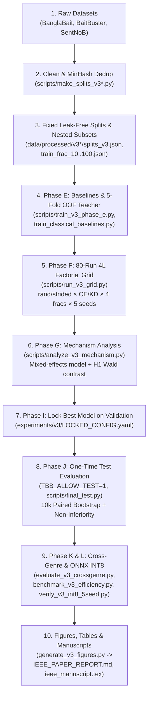

# TinyBanglaBERT — Beginner's Project Guide

Welcome to **TinyBanglaBERT**! This guide is a friendly, step-by-step tour of the entire project for someone who is new to this codebase (or still learning the basics of Machine Learning). By the end, you will understand what this project does, why each folder exists, how all the pieces connect, how to run it, and where to make changes.

---

## 1. Understanding the Project

### What is this project?
**TinyBanglaBERT** is a Machine Learning research project that detects **clickbait** in Bengali (Bangla) news headlines and YouTube titles using a **tiny, fast AI model** designed to run on everyday CPUs, phones, or web browsers.

- **Example of Not-Clickbait (`0`):** *"বৃষ্টির কারণে বাংলাদেশ-ভারত দ্বিতীয় টি-টোয়েন্টি ম্যাচ পরিত্যক্ত"* (Clearly states what happened.)
- **Example of Clickbait (`1`):** *"অবশেষে মুখ খুললেন অভিনেত্রী, কারণ জানলে চমকে যাবেন!"* (Withholds the real story to force you to click.)

### What problem does it solve?
Normally, to get high accuracy on Bengali text, researchers use a large pre-trained language model called **BanglaBERT-Base**. It has **110.6 million parameters** (learned numbers inside the neural network), takes **422 MB** of storage, and takes **~74–190 milliseconds** per headline on a CPU. That is too big and slow for a mobile app or browser extension.

This project builds **TinyBanglaBERT-4L** — a compact 4-layer model with only **7.42 million parameters** (**14.9× smaller** than BanglaBERT-Base) that runs in **1.77 milliseconds** on CPU after quantization.

### What is the scientific question behind the project?
When shrinking a big model ("Teacher") into a small model ("Student"), researchers usually use **Knowledge Distillation (KD)**: instead of training the student only on hard `0` or `1` labels, the student also learns from the teacher's soft probability scores (for example, *"75% sure it's clickbait, 25% not"*).

This project runs a controlled scientific study to answer one clear question:
> **When fine-tuning a tiny Bengali model, what matters more: how you initialize its starting weights (random weights vs. copying 4 pre-trained layers), or the training loss (standard Cross-Entropy vs. Knowledge Distillation)?**

### Main Features
1. **Leak-Free Data Pipeline:** Cleans Bengali text without breaking Bengali vowel marks (*matras*), removes near-duplicate headlines using **MinHash LSH** (a fast similarity-grouping algorithm), and locks the test set behind a code guard so training scripts can never accidentally peek at test labels.
2. **Controlled Experiments (v3):** Compares random vs. pre-trained (`strided`) initialization and Cross-Entropy vs. Knowledge Distillation across 4 dataset sizes (`10%`, `25%`, `50%`, `100%`) and 5 random seeds on **BanglaBait** (news headlines), **BaitBuster-Bangla** (YouTube titles), and **SentNoB** (3-class Bengali sentiment analysis).
3. **Rigorous Statistics:** Uses linear mixed-effects models, 10,000-resample paired bootstrap tests, Holm-Bonferroni multiple-testing correction, and formal **non-inferiority testing** (proving a tiny model stays within 2 percentage points of a bigger model).
4. **Edge Deployment & Quantization:** Exports models to **ONNX** format and compresses them to **INT8** (8-bit integers instead of 32-bit floats), measuring real CPU latency and simulating an edge–cloud cascade with mobile network delays.
5. **Explainability & Verification:** Includes SHAP and LIME word-importance tools plus **337 automated tests** that verify the math of every saved confusion matrix and ensure no data leakage.

### How it works at a high level
1. Download and clean Bengali text datasets, then group near-duplicates so no similar text leaks across train, validation, and test splits.
2. Train a large **Teacher** (`BanglaBERT-Base`) using 5-fold cross-validation so we get honest, unmemorized soft probability predictions for every training example.
3. Train **80 small 4-layer Student models** (varying initialization, loss function, data fraction, and random seed) on the training set and measure them on the validation set.
4. Analyze which factor (initialization vs. distillation) mattered most, lock the best model on validation, and unlock the held-out test set **once** for final scoring.
5. Export the winning models to ONNX FP32 and INT8 to measure CPU speed and generate publication-ready charts and reports.

---

## 2. Understanding the Folders and Files

Below is the clean folder structure of the repository (excluding temporary caches and virtual environment folders):

```text
tiny_bert/
├── src/                        # Reusable Python library code (the engine)
│   ├── data/                   # Loading, Bengali cleaning, MinHash dedup, splitting
│   ├── models/                 # Teacher & Student architectures, KD loss
│   ├── training/               # PyTorch datasets and HuggingFace trainers
│   ├── evaluation/             # Metrics, bootstrap stats, selective prediction, ablation
│   ├── efficiency/             # ONNX export, INT8 quantization, latency benchmarking
│   ├── explainability/         # SHAP & LIME word-attribution tools
│   └── utils/                  # Config loader, seeding, logging, test-set lock guard
│
├── scripts/                    # Runnable command-line scripts (each runs one pipeline stage)
├── configs/                    # YAML hyperparameter files (base.yaml + per-model overrides)
├── data/
│   ├── raw/                    # Raw downloaded data cache
│   └── processed/              # Clean CSVs, fixed split JSONs, nested subsets, OOF teacher logits
│       ├── v3/                 # Leak-free BanglaBait splits & OOF logits
│       ├── v3_baitbuster/      # Leak-free BaitBuster-Bangla splits & OOF logits
│       └── v3_sentnob/         # Leak-free SentNoB (3-class sentiment) splits
│
├── experiments/                # Saved checkpoints, metrics.json, CSV tables, charts, papers
│   ├── v3/                     # All v3 BanglaBait runs, reports, ONNX exports, and 300 DPI figures
│   ├── v3_baitbuster/          # All v3 BaitBuster-Bangla runs and reports
│   ├── v1_archive/             # Archived earlier drafts (preserved for history)
│   ├── IEEE_PAPER_REPORT.md    # Full v3 research paper in Markdown (with embedded figures)
│   ├── FINAL_RESULTS.md        # Concise summary of all final v3 numbers
│   └── ieee_manuscript.tex     # Publication-ready IEEE LaTeX manuscript
│
├── tests/                      # Automated pytest suite (337 tests)
├── prompts/                    # Zero-shot LLM prompt template (zero_shot.txt)
├── PREREG.md                   # Pre-registered hypotheses locked before v3 training
├── RELATED_WORK.md             # Academic literature review
├── ANNOTATION_GUIDE.md         # Rules for human native-speaker relabeling
├── pyproject.toml              # Project metadata, dependencies, pytest config
└── requirements-lock.txt       # Exact pinned package versions for reproducibility
```

### What each main folder does and why it is needed

| Folder / Group | What it does | Why it is needed | How it connects to the rest |
|---|---|---|---|
| **`src/data/`** | `load.py` and `load_crossdomain.py` download datasets from HuggingFace; `clean.py` normalizes Bengali Unicode; `dedup.py` clusters near-duplicates with MinHash LSH; `split.py` slices data by fixed indices. | Raw web text has invisible characters and duplicate headlines. Without deduplication, models memorize duplicates and look better than they really are. | Called by all `make_splits_*.py` and training scripts. `split.py` calls `src/utils/test_guard.py` whenever `split="test"` is requested. |
| **`src/models/`** | `student.py` builds the 7.42M 4-layer student (`init_small_random` for random weights, `init_from_small_pretrained` for copying `strided`/`first4`/`last4` layers); `distillation.py` defines `KnowledgeDistillationLoss` and `DistillationDataset`. | Guarantees that `rand` and `strided` students have the **exact same 7,417,346 parameters**, making comparisons scientifically fair. | Imported by `scripts/run_v3_grid.py` and `scripts/run_v3_sentnob.py`. |
| **`src/training/`** | `dataset.py` converts headlines (and optional article bodies) into tokenized tensors; `train_teacher.py` provides `WeightedTrainer` (supporting weighted/unweighted loss, label smoothing, R-Drop, and layer-wise learning rate decay). | Separates PyTorch training mechanics from experiment runner scripts so the same battle-tested trainer works for teachers and students. | Used by `scripts/train_v3_phase_e.py`, `scripts/run_v3_grid.py`, and legacy `scripts/train.py`. |
| **`src/evaluation/`** | `metrics.py` computes Accuracy, Macro-F1, confusion matrices, and threshold tuning; `selective.py` computes risk-coverage curves and edge–cloud cascade tradeoffs; `stats.py` and `ablation.py` run statistical summaries. | Ensures every script calculates metrics the exact same way and produces confusion matrices that pass consistency checks. | Imported by training, test evaluation, and cross-genre scripts. |
| **`src/utils/`** | `test_guard.py` enforces `TBB_ALLOW_TEST=1` before reading test labels; `seeding.py` fixes random seeds; `config_loader.py` merges YAML configs; `logging_utils.py` saves experiment logs. | Prevents accidental test-set leakage and ensures runs are repeatable. | Used across almost every file in `src/` and `scripts/`. |
| **`src/efficiency/` & `src/explainability/`** | `export_onnx.py` and `benchmark.py` export models to ONNX/INT8 and time CPU inference; `shap_runner.py`, `lime_runner.py`, and `agreement.py` measure which Bengali words drive predictions. | Proves the model is actually fast on CPU and lets humans inspect why a headline was flagged as clickbait. | Used by `scripts/benchmark.py`, `scripts/benchmark_v3_efficiency.py`, and `scripts/explain.py`. |
| **`scripts/`** | Command-line entry points you actually run in the terminal (data splitting, Phase E baselines/teachers, Phase F grid, Phase G stats, Phase J locked test, Phase K cross-genre, Phase L ONNX benchmark, figure generation). | Keeps runnable workflows separate from reusable library code in `src/`. | Imports from `src/`, reads from `data/` and `configs/`, writes results to `experiments/`. |
| **`configs/`** | `base.yaml` holds shared defaults (seed, paths, batch size, learning rate); experiment YAML files override only what changes. | Lets you tweak hyperparameters without editing Python code. | Loaded via `src/utils/config_loader.py`. |
| **`tests/`** | Automated `pytest` checks: `test_guard.py` (test lock), `test_dedup.py` (Bengali deduplication), `test_student.py` (parameter matching), `test_metric_consistency.py` (recomputes F1/Accuracy from every stored confusion matrix). | Catches silent bugs and reporting typos automatically before numbers ever reach a paper. | Run with `pytest` from the project root. |
| **Root Research Docs** | `PREREG.md` (hypotheses locked before training), `RELATED_WORK.md` (prior papers), `ANNOTATION_GUIDE.md` (human labeling rules), `README.md` (project overview). | Documents the scientific design and makes the study transparent for reviewers and collaborators. | Referenced by the final manuscripts in `experiments/`. |

---

## 3. How Everything Works Together

Here is the end-to-end flow of data and artifacts through the **v3 pipeline**:



### Step-by-Step Walkthrough
1. **Where it starts (Data Splitting):** You run `scripts/make_splits_v3.py`. It loads the raw headlines via `src/data/load.py`, cleans Bengali text via `src/data/clean.py`, clusters near-duplicates via `src/data/dedup.py`, drops label conflicts, and saves fixed row indices to `data/processed/v3/splits_v3.json` plus strictly nested `10% ⊂ 25% ⊂ 50% ⊂ 100%` training index files. *(Optionally, `scripts/attach_v3_bodies.py` attaches full article body text.)*
2. **Baselines & Teacher Soft Labels (Phase E):** `scripts/train_classical_baselines.py` trains TF-IDF + Logistic Regression. Then `scripts/train_v3_phase_e.py` trains BiLSTM, 5-seed `BanglaBERT-Base`, 5-seed `BanglaBERT-Small-12L`, and a **5-fold Out-of-Fold (OOF) Teacher** that saves clean soft logits to `data/processed/v3/teacher_oof_logits.pt`. None of these scripts can touch test labels.
3. **Controlled Student Grid (Phase F):** `scripts/run_v3_grid.py` reads the nested training subsets and OOF teacher logits, builds parameter-matched 7.42M 4-layer students via `src/models/student.py`, trains all 80 runs across 5 seeds, and saves `metrics.json`, `val_logits.npy`, and `val_loss_curve.json` inside `experiments/v3/<run_name>/seed<k>/`.
4. **Statistical Mechanism Analysis (Phase G):** `scripts/analyze_v3_mechanism.py` aggregates all 80 runs into `grid_master.csv`, fits the centered full-interaction mixed-effects model, computes the direct H1 Wald contrast, and writes `mechanism_report.md`.
5. **Lock & One-Time Test (Phases I & J):** After selecting the winning model on validation and recording it in `experiments/v3/LOCKED_CONFIG.yaml`, you set `TBB_ALLOW_TEST=1` and run `scripts/final_test.py` once. It evaluates the locked checkpoints on the held-out test set, runs 10,000-resample paired bootstrap tests with Holm correction, and saves `final_test_results.csv` and `final_test_report.md`.
6. **Cross-Genre, Edge Speed & Charts (Phases K, L & Reports):** `scripts/evaluate_v3_crossgenre.py` tests News $\rightarrow$ YouTube transfer with 1% threshold recalibration; `scripts/benchmark_v3_efficiency.py` and `scripts/verify_v3_int8_5seed.py` export ONNX FP32/INT8 models and verify 5-seed INT8 accuracy and CPU latency; `scripts/generate_v3_figures.py` renders all 6 high-resolution 300 DPI figures in `experiments/v3/figures/`.

---

## 4. Important Technologies

| Technology | What it is | Why this project uses it | Where it is used |
|---|---|---|---|
| **Python 3.11 / 3.12** | Main programming language for AI/ML. | Rich ML ecosystem and clean scripting. | Entire codebase (`src/`, `scripts/`, `tests/`). |
| **PyTorch** | Deep learning framework for building and training neural networks on GPU/CPU. | Powers all Transformer models, BiLSTM, custom Knowledge Distillation loss, and ONNX export. | `src/models/`, `src/training/`, `scripts/`. |
| **HuggingFace Transformers & Datasets** | Open-source library for pre-trained language models (`BanglaBERT`, `BanglaBERT-Small`) and public datasets. | Loads pre-trained Bengali weights, tokenizers, and datasets (`Motahar/banglabait`, `BaitBuster-Bangla`, `SentNoB`) cleanly. | `src/data/`, `src/models/`, `scripts/train_v3_phase_e.py`, `scripts/run_v3_grid.py`. |
| **ONNX Runtime** | High-performance C++ inference engine for running exported ML models on CPU/edge devices. | Converts PyTorch models to ONNX FP32 and **Dynamic INT8**, delivering 16.3×–25.8× like-for-like CPU speedups. | `src/efficiency/`, `scripts/benchmark_v3_efficiency.py`, `scripts/verify_v3_int8_5seed.py`. |
| **scikit-learn** | Classic ML and evaluation library. | `StratifiedGroupKFold` leak-free splitting, TF-IDF + Logistic Regression baseline, confusion matrices, and F1 metrics. | `src/evaluation/`, `scripts/make_splits_v3*.py`, `scripts/train_classical_baselines.py`. |
| **datasketch** | Fast probabilistic similarity library. | Runs **MinHash LSH** to detect near-duplicate Bengali headlines across 15,000+ rows in seconds. | `src/data/dedup.py`. |
| **statsmodels & SciPy** | Statistical modeling libraries. | Fits the linear mixed-effects model (`mixedlm`) and Wald contrasts for H1/H2, plus statistical tests. | `scripts/analyze_v3_mechanism.py`, `scripts/run_v3_sentnob.py`, `src/evaluation/stats.py`. |
| **OmegaConf & PyYAML** | Structured YAML configuration manager. | Merges `configs/base.yaml` with experiment-specific overrides cleanly. | `configs/`, `src/utils/config_loader.py`. |
| **Matplotlib & Seaborn** | Python plotting libraries. | Generates 300 DPI publication-grade learning curves, forest plots, latency charts, and confusion matrices. | `scripts/generate_v3_figures.py`, `scripts/analyze_v3_mechanism.py`. |
| **SHAP & LIME** | Model explainability libraries. | Highlights which Bengali words pushed the model toward "Clickbait" vs. "Not-Clickbait". | `src/explainability/`, `scripts/explain.py`. |
| **pytest** | Automated testing framework. | Runs 337 unit, guard, deduplication, and confusion-matrix math consistency checks. | `tests/`. |

---

## 5. How to Run the Project

### Prerequisites
- **Python 3.11 or 3.12**
- **Git**
- **Recommended:** An NVIDIA GPU with CUDA (8 GB VRAM is enough; all scripts automatically use `fp16` on GPU and fall back to CPU if no GPU is available).

### Step 1: Set Up the Virtual Environment (Windows PowerShell)
```powershell
# 1. Create and activate the virtual environment
python -m venv .venv
.\.venv\Scripts\Activate.ps1

# 2. Install exact pinned dependencies
.venv\Scripts\pip.exe install -r requirements-lock.txt
```
*(On Linux/macOS, use `source .venv/bin/activate` and `.venv/bin/pip`.)*

### Step 2: Verify the Installation Works
Run the automated test suite first. It checks the test-set lock, Bengali text cleaning, MinHash deduplication, parameter matching, and mathematical consistency of stored metrics:
```powershell
.venv\Scripts\pytest.exe tests/test_guard.py tests/test_dedup.py tests/test_metric_consistency.py tests/test_docs_consistency.py -q
```
You should see all tests pass with `0 failed`.

### Step 3: Run the Main v3 Pipeline (End to End)
Every training script is **resumable** — if a run is interrupted, re-running the same command automatically skips seeds that already have a `metrics.json` file.

```powershell
# 1. Build leak-free deduplicated splits & nested subsets (BanglaBait)
.venv\Scripts\python.exe -m scripts.make_splits_v3

# 2. Train classical baseline + Phase E teachers & 5-fold OOF soft labels
.venv\Scripts\python.exe -m scripts.train_classical_baselines
.venv\Scripts\python.exe -m scripts.train_v3_phase_e --dataset banglabait --text-mode title --models bilstm teacher_oof teacher_base small_12l

# 3. Run the 80-run controlled 4-layer Student factorial grid (Phase F)
.venv\Scripts\python.exe -m scripts.run_v3_grid --dataset banglabait --text-mode title --inits rand strided --objs ce kd --fracs 10 25 50 100

# 4. Run mixed-effects mechanism analysis (Phase G)
.venv\Scripts\python.exe -m scripts.analyze_v3_mechanism --dataset banglabait

# 5. Unlock the test set ONCE for held-out test evaluation (Phase J)
$env:TBB_ALLOW_TEST="1"; .venv\Scripts\python.exe -m scripts.final_test --dataset banglabait --models teacher_base teacher_base_tb baseline_small_12l_ce F_strided_kd_100 F_strided_ce_100 F_rand_kd_100 F_rand_ce_100
.venv\Scripts\python.exe -m scripts.compute_v3_full_contrasts

# 6. Run cross-genre evaluation, ONNX CPU benchmarking, 5-seed INT8 check & figures (Phases K & L)
.venv\Scripts\python.exe -m scripts.evaluate_v3_crossgenre
.venv\Scripts\python.exe -m scripts.benchmark_v3_efficiency
.venv\Scripts\python.exe -m scripts.verify_v3_int8_5seed
.venv\Scripts\python.exe -m scripts.generate_v3_figures
```

*(To run the Phase H second-task generalization experiment on 3-class **SentNoB** sentiment analysis, run `scripts.make_splits_v3_sentnob` followed by `scripts.run_v3_sentnob --stage all_val` and `--stage phase_j`.)*

---

## 6. Where to Make Changes

Use this quick lookup table whenever you want to modify or extend the project:

| What you want to do | Where to look | What to edit |
|---|---|---|
| **Change Bengali text cleaning rules** | `src/data/clean.py` and `src/data/dedup.py` | Edit `clean_headline()` or `norm_text()` (always run `pytest tests/test_data_clean.py tests/test_dedup.py` afterward so Bengali vowel marks aren't broken). |
| **Change student architecture or layer selection** | `src/models/student.py` | Edit `_select_teacher_layers()` (e.g., to add a new layer pattern) or `init_from_small_pretrained()` / `init_small_random()`. |
| **Change Knowledge Distillation loss ($T$, $\alpha$, or loss formula)** | `src/models/distillation.py` and `scripts/run_v3_grid.py` | Edit `KnowledgeDistillationLoss.forward()` for loss math, or `FIXED_T` / `FIXED_ALPHA` / `FIXED_LR` constants at the top of `scripts/run_v3_grid.py`. |
| **Change default hyperparameters for legacy/config-driven runs** | `configs/base.yaml` (and specific `configs/*.yaml`) | Update `training.lr`, `training.epochs`, `distillation.temperature`, etc. |
| **Add a new dataset or NLP task** | `scripts/make_splits_v3_sentnob.py` and `scripts/run_v3_sentnob.py` | Copy these two files as a template — they already support multi-class (`NUM_LABELS = 3`) MinHash splitting, OOF teacher generation, 80-run grid, mixed-effects analysis, and locked test evaluation. |
| **Add a new baseline model (e.g., another HuggingFace encoder)** | `scripts/train_v3_phase_e.py` | Add a new `--models` option in `main()` calling `train_hf_model(...)`. |
| **Change statistical tests or non-inferiority margin** | `scripts/final_test.py` and `scripts/analyze_v3_mechanism.py` | Update `NON_INFERIORITY_MARGIN` (`0.020`) in `final_test.py`, or the regression formula / Wald contrast in `analyze_v3_mechanism.py`. |
| **Change ONNX export or CPU thread benchmarking** | `scripts/benchmark_v3_efficiency.py` | Edit `candidates`, `threads`, `warmup`, `runs`, or cascade RTT values (`50.0`, `150.0`). |
| **Customize charts and plots** | `scripts/generate_v3_figures.py` | Each of the 6 figures has its own clean function (`fig1_...` through `fig6_...`) reading directly from the CSVs in `experiments/v3/`. |
| **Debug a failing metric or leakage check** | `tests/test_metric_consistency.py` and `tests/test_guard.py` | Run `pytest -v` to see the exact file and metric key that mismatched, or which script attempted to read test labels without `TBB_ALLOW_TEST=1`. |
