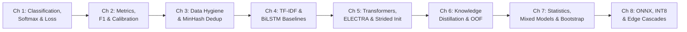

# TinyBanglaBERT — Machine Learning & Computer Science Learning Guide

Welcome! This document is a progressive, university-style mini-course built around the **TinyBanglaBERT** codebase. Instead of abstract textbook theory, every concept—from basic probability and classification to Transformers, Knowledge Distillation, Mixed-Effects Statistics, and INT8 Quantization—is taught **in dependency order** and tied directly to the actual Python files and experiments in this repository.

> **How to read this guide:** Go chapter by chapter. Each chapter introduces concepts using plain intuition first, then the mechanism, a worked numerical example, the math, and the exact code in this project. Try the short exercises at the end of each chapter before checking Chapter 9.

---

## Course Map



---

## Chapter 1: Supervised Classification, Logits, Softmax & Cross-Entropy

### 1. What is it & why does it matter?
In **supervised text classification**, we give a model labeled examples $(x, y)$—here, a Bengali headline $x$ and a label $y \in \{0, 1\}$ (`0` = Not-Clickbait, `1` = Clickbait; or $\{0, 1, 2\}$ for 3-class sentiment in SentNoB). The model's job is to output a probability for each class so we can make a decision.

### 2. How does it work? (Logits $\to$ Softmax $\to$ Cross-Entropy)
A neural network does not directly output probabilities. Its final linear layer outputs raw, unbounded real numbers called **logits**, denoted $z = [z_0, z_1]$.
- For example, $z = [-1.0, +2.0]$ means the model leans strongly toward Class 1 (Clickbait).

To turn raw logits into valid probabilities that are positive and sum to $1$, we apply the **Softmax** function:
$$p_i = \text{softmax}(z)_i = \frac{e^{z_i}}{\sum_{j=1}^{C} e^{z_j}}$$
where $C$ is the number of classes ($C=2$ for clickbait, $C=3$ for SentNoB), $z_i$ is the logit for class $i$, and $p_i \in (0, 1)$ is the predicted probability.

**Worked Numerical Example:**
Suppose $z = [0.0, 2.0]$:
- $e^0 = 1.00$, $e^2 \approx 7.39$. Sum $= 8.39$.
- $p_0 = 1.00 / 8.39 \approx 0.119$ (11.9% Not-Clickbait)
- $p_1 = 7.39 / 8.39 \approx 0.881$ (88.1% Clickbait)

During training, we measure how wrong the model is using **Cross-Entropy Loss**:
$$\mathcal{L}_{\text{CE}} = -\log(p_y)$$
where $p_y$ is the probability the model assigned to the *true* class $y$.
- If the true label is $y = 1$ and $p_1 = 0.881$, then $\mathcal{L}_{\text{CE}} = -\ln(0.881) \approx 0.127$ (small penalty!).
- If the true label was actually $y = 0$ ($p_0 = 0.119$), then $\mathcal{L}_{\text{CE}} = -\ln(0.119) \approx 2.128$ (big penalty!).

### 3. Class Weights & Label Smoothing *(Optional Advanced)*
- **Class Weights:** In BanglaBait, 65.2% of headlines are Not-Clickbait and 34.8% are Clickbait. Multiplying the loss of minority-class mistakes by a larger weight $w_y$ pushes the model to pay more attention to Clickbait.
- **Label Smoothing ($\epsilon = 0.05$):** Instead of forcing the model to be 100% certain (`[0, 1]`), we soften the target to `[0.025, 0.975]`. This prevents overconfidence on noisy labels.

### 4. Connection to This Project
Look at `WeightedTrainer.compute_loss()` in `src/training/train_teacher.py`:
```python
weights = self.class_weights.to(logits.device) if self.class_weights is not None else None
smoothing = self.label_smoothing if model.training else 0.0
loss_fct = nn.CrossEntropyLoss(weight=weights, label_smoothing=smoothing)
loss = loss_fct(logits.view(-1, self.model.config.num_labels), labels.view(-1))
```
PyTorch's `nn.CrossEntropyLoss` combines `LogSoftmax` and negative log-likelihood in one numerically stable step.

### 5. Before Moving Forward
Make sure you understand: (a) logits can be any real number, (b) Softmax turns logits into probabilities summing to 1, and (c) Cross-Entropy penalizes confident wrong predictions exponentially harder than slight uncertainty.

### Exercise 1
A model outputs logits $z = [1.0, 1.0]$ for a headline whose true label is $y = 1$.
1. Compute the Softmax probabilities $p_0$ and $p_1$.
2. Compute the Cross-Entropy loss $\mathcal{L}_{\text{CE}} = -\ln(p_1)$.

---

## Chapter 2: Evaluating Classifiers Honestly (Confusion Matrices, Macro-F1 & ECE)

### 1. What is it & why does it matter?
Imagine a dataset where 90% of headlines are Not-Clickbait. A lazy model that predicts "Not-Clickbait" for *everything* gets **90% Accuracy** while catching **0% of clickbait**! That is why **Accuracy alone is dangerous on imbalanced datasets** like BanglaBait (65.2% / 34.8%).

### 2. Confusion Matrix, Precision, Recall & Macro-F1
Every binary classifier's predictions fall into four buckets (the **Confusion Matrix**):
- **TN (True Negative):** Correctly predicted Not-Clickbait.
- **FP (False Positive):** Real news wrongly flagged as Clickbait (harms legitimate journalists!).
- **FN (False Negative):** Clickbait missed by the model.
- **TP (True Positive):** Correctly caught Clickbait.

From these 4 integers, we compute for each class $c$:
$$\text{Precision}_c = \frac{\text{TP}_c}{\text{TP}_c + \text{FP}_c}, \qquad \text{Recall}_c = \frac{\text{TP}_c}{\text{TP}_c + \text{FN}_c}, \qquad \text{F1}_c = \frac{2 \cdot \text{Precision}_c \cdot \text{Recall}_c}{\text{Precision}_c + \text{Recall}_c}$$
- **Precision** asks: *"When I yell clickbait, how often am I right?"*
- **Recall** asks: *"Of all real clickbait out there, how much did I catch?"*
- **F1** is their harmonic mean—if either Precision or Recall is near zero, F1 collapses.
- **Macro-F1** averages $\text{F1}_0$ and $\text{F1}_1$ equally: $\text{Macro-F1} = \frac{1}{2}(\text{F1}_0 + \text{F1}_1)$, giving equal importance to the minority Clickbait class.

### 3. Expected Calibration Error (ECE)
Suppose a model says *"I am 90% confident"* on 100 headlines, but it is actually right on only 70 of them. That model is **miscalibrated** (overconfident).
**ECE** divides predictions into $M = 10$ confidence bins (e.g., 50–60%, 60–70%, …, 90–100%) and measures the weighted average gap between confidence and actual accuracy:
$$\text{ECE} = \sum_{m=1}^{M} \frac{|B_m|}{N} \left| \text{acc}(B_m) - \text{conf}(B_m) \right|$$
Lower ECE ($\downarrow$) means you can trust the model's probability score—crucial for deciding when to escalate an uncertain headline to a cloud model!

### 4. Connection to This Project
- **`scripts/train_v3_phase_e.py`** (`compute_full_metrics` and `compute_ece`): Computes all metrics directly from the confusion matrix and softmax probabilities.
- **`tests/test_metric_consistency.py`**: Automatically scans all 320+ `metrics.json` files in `experiments/`, recomputes Accuracy, Precision, Recall, and Macro-F1 from the saved confusion matrix, and fails the test suite if any number drifts by more than $10^{-3}$.
- **`src/evaluation/metrics.py`** (`find_optimal_threshold`): Tunes the decision threshold on validation (or 1% of cross-genre target data) instead of blindly assuming `0.50`.

### 5. Before Moving Forward
Understand why Macro-F1 is our primary metric in `PREREG.md`, why we store confusion matrices everywhere, and what ECE measures.

### Exercise 2
Suppose a model's confusion matrix on 100 test headlines is `TN=55, FP=5, FN=10, TP=30`.
1. Calculate Accuracy.
2. Calculate Clickbait (Class 1) Precision, Recall, and F1.

---

## Chapter 3: Data Hygiene & Leakage Prevention

### 1. Why Data Leakage Ruins ML Research
If the same headline (or a nearly identical rewording with a different exclamation mark) appears in both the **training set** and the **test set**, the model simply memorizes it. Your test score looks artificially high, but the model fails on truly unseen news.

### 2. Bengali-Safe Unicode Cleaning
In Unicode, Bengali words use base consonants plus **combining vowel marks** (*matras* like `া`, `ি`, `ে`, and *virama* `্`).
- **The bug many beginners hit:** Running Python's `char.isalnum()` strips combining marks because Unicode classifies them as category `Mn`/`Mc` (Marks), not Letters (`L`), corrupting Bengali words!
- **Our fix (`src/data/clean.py` & `src/data/dedup.py`):** First normalize to **NFC** (canonical composed form), strip invisible zero-width joiners (`\u200B`–`\u200D`, `\uFEFF`), and explicitly keep Unicode categories `("L", "N", "M")`.

### 3. MinHash LSH (Finding Near-Duplicates Fast)
Comparing all pairs of $N = 15,056$ headlines directly takes $\frac{N(N-1)}{2} \approx 113\text{ million}$ string comparisons—way too slow.
**How MinHash LSH solves it in seconds:**
1. **Character 3-shingles:** Break each headline into overlapping 3-character chunks (e.g., `"ঢাকা"` $\to$ `{"ঢাক", "াকা"}`).
2. **Jaccard Similarity:** Two sets $A, B$ have similarity $J(A, B) = \frac{|A \cap B|}{|A \cup B|} \in [0, 1]$.
3. **MinHash:** Hash every shingle with 128 independent hash functions and keep the minimum hash value for each. A famous theorem proves that the fraction of matching minimum hashes equals $J(A, B)$ in expectation!
4. **LSH (Locality-Sensitive Hashing) + Union-Find:** Buckets similar MinHash signatures together so we only compare likely duplicates, then merges connected pairs into `group_id` clusters ($J \ge 0.90$).

### 4. StratifiedGroupKFold & Test-Set Lock
- **StratifiedGroupKFold (`n_splits=10`):** Splits data into 10 folds while keeping two guarantees simultaneously: (1) every fold has the same clickbait percentage (*Stratified*), and (2) **no `group_id` ever appears in two different splits** (*Group*). Fold 0 = Test, Fold 1 = Validation, Folds 2–9 = Train.
- **Test-Set Lock (`src/utils/test_guard.py`):**
```python
def assert_test_access() -> None:
    if os.environ.get("TBB_ALLOW_TEST") != "1":
        raise TestSetLocked(
            "Test labels are locked. Only scripts/final_test.py may set TBB_ALLOW_TEST=1."
        )
```
Called inside `apply_splits(..., split="test")` in `src/data/split.py`. Even if a programmer accidentally tries to read test labels during training, Python immediately crashes with `TestSetLocked`.

### 5. Connection to This Project
- `src/data/dedup.py` (`norm_text`, `get_shingles`, `compute_near_dup_groups`)
- `scripts/make_splits_v3.py` (BanglaBait), `scripts/make_splits_v3_baitbuster.py` (BaitBuster), `scripts/make_splits_v3_sentnob.py` (SentNoB)
- `scripts/make_splits_v3_baitbuster_channel.py`: Our channel audit script that uncovered BaitBuster-Bangla's 13-channel confounding (94.7% of non-clickbait from one TV station!).

### Exercise 3
Compute the 3-shingle Jaccard similarity between `"cat!"` (normalized: `"cat"`) and `"cats"` (`"cats"`).
*(Hint: 3-shingles of `"cat"` = `{"cat"}`; 3-shingles of `"cats"` = `{"cat", "ats"}`.)*

---

## Chapter 4: Classical & Recurrent Baselines (TF-IDF + LogReg & BiLSTM)

### 1. Why Train Simple Baselines First?
Before celebrating a Transformer, you must prove it beats simpler, faster models. If a 1-second linear model scores 0.70 F1 and a 110M Transformer scores 0.71, the Transformer isn't worth the cost!

### 2. TF-IDF + Logistic Regression
- **TF-IDF (Term Frequency – Inverse Document Frequency):** Converts text into a sparse vector where each word or 2-word phrase (*bigram*) gets a score:
  $$\text{TF-IDF}(t, d) = \text{TF}(t, d) \times \log\left(\frac{N}{1 + \text{df}(t)}\right)$$
  Common filler words appearing in almost every headline get a score near 0; rare clickbait trigger words like `"ভাইরাল"` (viral) or `"চমকে"` (shocked) get high weights.
- **Logistic Regression:** Learns one weight $w_j$ per n-gram and computes $p(\text{clickbait}) = \sigma(w^\top x + b)$.
- **In this project (`scripts/train_classical_baselines.py`):** Scores **0.6922** Macro-F1 on BanglaBait validation across 5 seeds. Fast, interpretable, but misses word order and deep context.

### 3. WordPiece Tokenization & BiLSTM
- **WordPiece Tokenization:** Splits rare or morphologically complex Bengali words into known subword pieces (from a 32,000-token vocabulary), preventing "unknown word" errors.
- **BiLSTM (Bidirectional Long Short-Term Memory):** Reads the headline token-by-token both left-to-right ($\overrightarrow{h}$) and right-to-left ($\overleftarrow{h}$), maintaining a memory cell that captures sequential phrasing, then concatenates the final hidden states into a linear classifier.
- **In this project (`BiLSTMClassifier` in `scripts/train_v3_phase_e.py`):** 4.76M parameters, scores **0.7342 ± 0.0065** Macro-F1 (+4.2 pp over TF-IDF), showing that word order matters.

### Exercise 4
Why can a **BiLSTM** distinguish *"ভালো সিনেমা না"* ("not a good movie") from *"সিনেমা ভালো না?"* better than a unigram TF-IDF model?

---

## Chapter 5: Transformers, Self-Attention, ELECTRA & Strided Initialization

### 1. Why Transformers Beat BiLSTMs
An LSTM processes words one by one sequentially, making it slow to train and weak on long-range dependencies. A **Transformer** looks at **all words in the headline simultaneously** using **Self-Attention**.

### 2. Scaled Dot-Product Self-Attention (The Core Mechanism)
Every token $i$ creates three learned vectors: a **Query** ($q_i$, *"what am I looking for?"*), a **Key** ($k_i$, *"what do I contain?"*), and a **Value** ($v_i$, *"what information do I pass along?"*). Stacking all tokens into matrices $Q, K, V$:
$$\text{Attention}(Q, K, V) = \text{softmax}\left(\frac{Q K^\top}{\sqrt{d_k}}\right) V$$
- $Q K^\top$ computes the dot-product similarity between every pair of words in the sentence.
- Dividing by $\sqrt{d_k}$ keeps gradients stable when the head dimension $d_k$ is large (here $d_k = 64$).
- **Multi-Head Attention** runs $H$ parallel attention heads ($H = 12$ in Base, $H = 4$ in TinyBanglaBERT-4L) so different heads can track grammar, sentiment, and clickbait cues at the same time.

### 3. ELECTRA Pre-Training (How BanglaBERT Learned Bengali)
Instead of BERT's Masked Language Modeling (hiding 15% of tokens and guessing them), **BanglaBERT** uses **ELECTRA** (Replaced Token Detection): a small generator replaces some words with plausible fakes, and the main encoder (Discriminator) must judge **every single token** as *Original* or *Replaced*. Learning from 100% of tokens instead of 15% makes ELECTRA dramatically more sample-efficient—especially for compact models like `csebuetnlp/banglabert_small`.

### 4. Factorized Embeddings & Strided Layer Transfer (Our Core Architecture)
Look at the exact architectural difference between Teacher and Student:

| Component | BanglaBERT-Base (Teacher) | BanglaBERT-Small-12L | **TinyBanglaBERT-4L (Student)** |
|---|---:|---:|---:|
| Encoder Layers ($L$) | 12 | 12 | **4** |
| Embedding Size ($d_e$) | 768 | 128 (factorized) | **128 (factorized)** |
| Hidden Size ($d_h$) | 768 | 256 | **256** |
| Attention Heads ($H$) | 12 | 4 | **4** |
| Total Parameters | **110.62M** | **13.74M** | **7.42M (14.9× smaller)** |

- **Why Factorized Embeddings ($128 \to 256$)?** A 32,000-word embedding table at size 768 takes $32{,}000 \times 768 = 24.6\text{M}$ parameters alone! Storing embeddings at size 128 ($4.1\text{M}$ params) and projecting $128 \to 256$ saves massive memory.
- **Why Strided Layer Selection ($L_S = \{2, 5, 8, 11\}$)?** Early Transformer layers capture basic syntax/spelling; middle layers capture phrases; top layers capture high-level semantics. Taking evenly spaced layers `[2, 5, 8, 11]` from the 12-layer pre-trained `BanglaBERT-Small` preserves the entire linguistic hierarchy!
- **Strict Parameter Matching (`src/models/student.py`):**
  - `init_from_small_pretrained(..., layer_selection="strided")` copies embeddings + layers `[2, 5, 8, 11]`.
  - `init_small_random(num_hidden_layers=4)` builds the **exact same 7,417,346-parameter architecture** with fresh random Gaussian weights. This guarantees that any accuracy gap between `strided` and `rand` comes 100% from **pre-trained initialization**, not model size!

### Exercise 5
Calculate how many parameters the word embedding matrix alone has when `vocab_size = 32,000` and (a) `embedding_size = 768` vs. (b) `embedding_size = 128`. How many million parameters does factorization save?

---

## Chapter 6: Knowledge Distillation & Out-of-Fold Soft Labels

### 1. The Intuition Behind "Dark Knowledge"
Hard labels (`0` or `1`) treat every headline equally: a subtle borderline news headline and an outrageous *"জানলে চমকে যাবেন!"* headline both just say `1`.
A trained Teacher's **soft probabilities** carry richer "dark knowledge"—telling the student *which* examples are crystal-clear (`0.98`) and *which* are ambiguous (`0.56`).

### 2. Temperature Scaling & Hinton's Distillation Loss
If we soften the logits by dividing by a **Temperature** $T > 1$ (we use $T = 4.0$):
$$p_i^{(T)} = \text{softmax}(z / T)_i = \frac{e^{z_i / T}}{\sum_j e^{z_j / T}}$$
Higher $T$ flattens sharp peaks so the student can see subtle probability ratios.

We then measure how far the student's softened distribution $p_S^{(T)}$ is from the teacher's $p_T^{(T)}$ using **Kullback-Leibler (KL) Divergence**, and combine it with regular hard-label Cross-Entropy:
$$\mathcal{L}_{\text{KD}} = \alpha \, \mathcal{L}_{\text{CE}}(z_S, y) + (1 - \alpha) \, T^2 \, D_{\text{KL}}\!\left(p_T^{(T)} \,\|\, p_S^{(T)}\right)$$
- $\alpha = 0.5$ balances hard ground-truth labels and soft teacher targets equally.
- **Why multiply by $T^2$?** Dividing logits by $T$ shrinks the gradients of the KL term by $1/T^2$. Multiplying by $T^2$ restores the gradient scale so hard and soft losses stay balanced!

### 3. Why 5-Fold Out-of-Fold (OOF) Soft Labels Are Essential
If you train a Teacher on 100% of `train` and immediately run it on `train` to generate soft labels, it has **memorized** those rows—its probabilities become overconfident (`0.999` vs `0.001`), destroying the dark knowledge!
Instead, `generate_v3_oof_teacher()` in `scripts/train_v3_phase_e.py` splits `train` into 5 group-disjoint folds: Fold $k$'s soft labels are predicted by a Teacher trained *only* on the other 4 folds.

### 4. Connection to This Project
Look at `KnowledgeDistillationLoss.forward()` in `src/models/distillation.py`:
```python
student_log_probs = F.log_softmax(student_logits / T, dim=-1)
teacher_probs = F.softmax(teacher_logits / T, dim=-1)
soft_loss = self.kl_div(student_log_probs, teacher_probs) * (T * T)
total_loss = (self.alpha * hard_loss) + ((1.0 - self.alpha) * soft_loss)
```
And critically, in `scripts/run_v3_grid.py`, we set `remove_unused_columns=False` in `TrainingArguments`—otherwise HuggingFace's `Trainer` silently strips `teacher_logits` from batches!

### Exercise 6
Take logits $z = [0.0, 2.0]$. In Chapter 1 ($T=1$), $p_1 = 0.881$. Now divide by $T = 4.0$ to get $z/T = [0.0, 0.5]$, and compute the softened probability $p_1^{(4)}$. Notice how much softer the distribution becomes!

---

## Chapter 7: Experimental Design & Research Statistics

### 1. Why 5 Random Seeds & Controlled Factorial Grids?
Neural network training has randomness (weight initialization, batch shuffling). A single seed can easily fluctuate by $\pm 1.0$ pp. Running **5 fixed seeds** (`[13, 42, 87, 1234, 2026]`) lets us report honest means, standard deviations, and 95% confidence intervals.

### 2. Linear Mixed-Effects Model (Separating Signal from Seed Noise)
In Phase F, we run a $2 \times 2 \times 4 \times 5 = 80$-run factorial grid (`rand`/`strided` $\times$ `ce`/`kd` $\times$ `10/25/50/100%` $\times$ 5 seeds). To measure the exact effect of each factor and their interactions simultaneously, we fit:
$$\text{Macro-F1} = \beta_0 + \beta_1 \text{Init} + \beta_2 \text{Obj} + \beta_3 \text{log\_frac\_c} + \text{interactions} + u_{\text{seed}} + \varepsilon$$
- **Why center `log_frac_c = log(frac) - mean(log(frac))`?** Without centering, $\beta_1$ and $\beta_2$ are evaluated at $\log(\text{frac}) = 0$ (i.e., `1%` data—an unrealistic extrapolation!). Centering evaluates main effects at the geometric mean of the actual data fractions.
- **Direct H1 Wald Contrast ($\beta_{\text{strided}} - \beta_{\text{kd}}$):** Testing $\beta_{\text{strided}} > 0$ only proves initialization helps; testing $\beta_{\text{strided}} - \beta_{\text{kd}} > 0$ directly proves initialization helps **more than KD** (`+2.26 pp` on BanglaBait).

### 3. Paired Bootstrap, Holm Correction & Non-Inferiority Testing
On the locked held-out test set (`scripts/final_test.py` and `scripts/compute_v3_full_contrasts.py`):
- **Paired Bootstrap (10,000 resamples):** Randomly resample test headlines (with replacement) and seeds 10,000 times, compute $\text{F1}_A - \text{F1}_B$ each time, and take the 2.5th and 97.5th percentiles for the **95% Confidence Interval (CI)**. Because both models are evaluated on the exact same resampled headlines, it has much higher statistical power than unpaired tests.
- **Holm-Bonferroni Correction:** When you run $m$ hypothesis tests at once, the chance of a false positive grows. Holm correction sorts p-values from smallest to largest and multiplies the $k$-th p-value by $(m - k + 1)$ to control the family-wise error rate.
- **Non-Inferiority ($\Delta = -2.0$ pp):** A tiny model is formally **non-inferior** to a big model only if the **lower bound** of its 95% CI is $\ge -2.0$ pp.
  - On BanglaBait: `4L Strided + KD` vs. `Small-12L` is `-0.06 pp`, CI `[-1.71, +1.56]` $\to$ **Non-Inferior (True!)** because $-1.71 \ge -2.0$.
  - `4L Strided + KD` vs. `Teacher Base` is `-1.86 pp`, CI `[-3.65, -0.13]` $\to$ **Non-Inferior (False!)** because $-3.65 < -2.0$.

### Exercise 7
Model A beats Model B on held-out test with a 95% paired bootstrap CI of `[-1.40, +0.20]` pp. Under a pre-registered non-inferiority margin of $\Delta = -2.0$ pp:
1. Is Model A statistically superior to Model B?
2. Is Model A formally non-inferior to Model B?

---

## Chapter 8: Edge AI Efficiency (ONNX, INT8 Quantization & Cascades)

### 1. ONNX Runtime (Removing Python Overhead)
PyTorch is great for training, but during inference it carries Python interpreter overhead. **ONNX (Open Neural Network Exchange)** freezes the neural network into a static computation graph that **ONNX Runtime** runs in optimized C++ with operator fusion (combining matrix multiply + bias + LayerNorm into faster CPU kernels).

### 2. Dynamic INT8 Quantization (4× Smaller Weights)
Normally, every weight is stored as a 32-bit floating-point number (**FP32**, 4 bytes). **Dynamic INT8 Quantization** maps each weight matrix's real range $[w_{\min}, w_{\max}]$ onto 8-bit integers (`0..255`, 1 byte) using a scale $s$ and zero-point $z_0$:
$$w_q = \text{round}\!\left(\frac{w}{s}\right) + z_0, \qquad s = \frac{w_{\max} - w_{\min}}{255}$$
During inference, integer matrix multiplications (`MatMul`, `Gemm`) execute much faster using modern CPU vector instructions (AVX2/VNNI), cutting disk size and latency dramatically.
- **Our verified 5-seed result (`scripts/benchmark_v3_efficiency.py`, `scripts/verify_v3_int8_5seed.py`):**
  - `TinyBanglaBERT-4L INT8` (4 threads): **1.77 ms p50** (2.39 ms p95), **19.20 MB** — **16.3× faster like-for-like** than Base INT8 (28.79 ms) and **25.8× faster** in FP32 vs. FP32 (2.89 ms vs. 74.46 ms), with only **-0.02 pp** Macro-F1 change across 5 seeds!

### 3. Edge–Cloud Deferral Cascade
What if a headline is ambiguous? In a **2-tier cascade**, `TinyBanglaBERT-4L INT8` runs locally on the phone in $L_{\text{edge}} = 1.77\text{ ms}$. Only the fraction $r$ of uncertain headlines (e.g., $r = 10\%$) are sent over the mobile network (Round-Trip Time $\text{RTT} \in \{50, 150\}\text{ ms}$) to the cloud Teacher ($L_{\text{cloud}} = 74.46\text{ ms}$):
$$L_{\text{cascade}} = L_{\text{edge}} + r \cdot (L_{\text{cloud}} + \text{RTT})$$
At $r = 10\%$ and $\text{RTT} = 150\text{ ms}$: $1.77 + 0.10 \times (74.46 + 150) = \mathbf{24.22\text{ ms}}$, versus **224.46 ms** ($150 + 74.46$) for cloud-only inference!

### Exercise 8
Using $L_{\text{edge}} = 1.77\text{ ms}$, $L_{\text{cloud}} = 74.46\text{ ms}$, and $\text{RTT} = 50\text{ ms}$, calculate the effective average cascade latency when 25% of headlines are escalated ($r = 0.25$).

---

## Chapter 9: Answer Key & Hints for Exercises

- **Exercise 1:** (1) $e^1 / (e^1 + e^1) = 0.50$, so $p_0 = 0.50, p_1 = 0.50$. (2) $\mathcal{L}_{\text{CE}} = -\ln(0.50) \approx 0.6931$. (This is the classic "random coin-flip" starting loss for any binary classifier!)
- **Exercise 2:** (1) $\text{Acc} = (55 + 30) / 100 = 85.0\%$. (2) $\text{Precision}_1 = 30 / (30 + 5) = 0.8571$; $\text{Recall}_1 = 30 / (30 + 10) = 0.7500$; $\text{F1}_1 = 2(0.8571)(0.75) / (0.8571 + 0.75) \approx 0.8000$.
- **Exercise 3:** Intersection $= \{\text{"cat"}\}$ (size 1); Union $= \{\text{"cat"}, \text{"ats"}\}$ (size 2). $J = 1/2 = 0.50$.
- **Exercise 4:** Unigram TF-IDF treats a sentence as an unordered bag of words, so word placement of negation (`"না"`) is lost. A BiLSTM reads tokens sequentially in both directions, capturing how `"না"` modifies `"ভালো"`.
- **Exercise 5:** (a) $32{,}000 \times 768 = 24{,}576{,}000$ (~24.58M params). (b) $32{,}000 \times 128 = 4{,}096{,}000$ (~4.10M params). Factorization saves **~20.48 million parameters**!
- **Exercise 6:** $e^0 = 1.00$, $e^{0.5} \approx 1.6487$. Sum $= 2.6487$. $p_1^{(4)} = 1.6487 / 2.6487 \approx 0.6225$ (down from `0.881` at $T=1$!).
- **Exercise 7:** (1) **No** — the 95% CI crosses 0 (`-1.40` to `+0.20`). (2) **Yes** — the lower bound `-1.40` is strictly above `-2.0` pp.
- **Exercise 8:** $1.77 + 0.25 \times (74.46 + 50) = 1.77 + 31.115 \approx \mathbf{32.89\text{ ms}}$ (matches `experiments/v3/cascade_rtt_table.csv`!).

---

## Chapter 10: Final Knowledge Assessment

### Summary of What You Learned
You now understand the full scientific stack of TinyBanglaBERT: from Bengali-safe text cleaning and MinHash LSH deduplication, through Softmax, Cross-Entropy, Macro-F1, and ECE, to ELECTRA Transformers, factorized embeddings, strided layer transfer, OOF Knowledge Distillation, centered mixed-effects models, paired bootstrap non-inferiority testing, and ONNX Dynamic INT8 edge acceleration.

### Glossary of Key Terms
| Term | Plain-English Definition |
|---|---|
| **Logits** | Raw, unnormalized numbers output by a neural network before Softmax. |
| **Macro-F1** | Unweighted average of per-class F1 scores; treats minority and majority classes equally. |
| **ECE (Expected Calibration Error)** | Average gap between a model's predicted confidence and its actual accuracy (lower is better). |
| **MinHash LSH** | Fast hashing algorithm that groups near-duplicate texts by approximate Jaccard similarity. |
| **StratifiedGroupKFold** | Cross-validation split that preserves class balance while keeping all items of a group in one split. |
| **Factorized Embedding** | Storing word embeddings in a smaller dimension (128) and projecting up to hidden size (256) to save parameters. |
| **Strided Layer Transfer** | Copying evenly spaced layers (e.g., `[2, 5, 8, 11]`) from a 12-layer encoder into a 4-layer student. |
| **Out-of-Fold (OOF) Logits** | Training-set teacher predictions made by a fold that never trained on those specific rows. |
| **Linear Mixed-Effects Model** | Regression model that includes both fixed experimental factors (`init`, `obj`) and random grouping effects (`seed`). |
| **Non-Inferiority Margin ($\Delta$)** | Maximum acceptable drop (here `-2.0` pp) to declare a smaller model practically as good as a larger reference. |
| **Dynamic INT8 Quantization** | Compressing 32-bit float weights to 8-bit integers for smaller size and faster CPU matrix math. |

### 16 Self-Test Questions
1. Why is Accuracy misleading on BanglaBait, and why did we choose Macro-F1 as our primary metric?
2. What happens if you call `str.isalnum()` on Bengali text during preprocessing?
3. Explain why MinHash LSH + `StratifiedGroupKFold` is superior to a standard random `train_test_split`.
4. What does `src/utils/test_guard.py` protect against, and how is it unlocked?
5. Why do we train TF-IDF + Logistic Regression and BiLSTM before Transformers?
6. In Scaled Dot-Product Attention, why do we divide $Q K^\top$ by $\sqrt{d_k}$?
7. How does ELECTRA pre-training differ from BERT's Masked Language Modeling?
8. Why was it critical for `init_small_random()` and `init_from_small_pretrained()` to have the exact same 7.42M parameter count?
9. Why does Hinton's distillation loss multiply the KL divergence term by $T^2$?
10. What goes wrong if you generate teacher soft labels on the training set without using Out-of-Fold (OOF) cross-validation?
11. Why did `Trainer` silently fail to distill before we added `remove_unused_columns=False`?
12. Why did we center `log_frac` (`log_frac_c`) in the linear mixed-effects model?
13. Why is a direct Wald contrast ($\beta_{\text{strided}} - \beta_{\text{kd}}$) needed to test H1, rather than just checking if $\beta_{\text{strided}}$ is significant?
14. Explain the difference between "no statistically significant difference ($p > 0.05$)" and "formal non-inferiority."
15. What dataset-hygiene flaw did our channel audit uncover in the 10,000-row human-labeled `BaitBuster-Bangla` subset?
16. Why is comparing Student INT8 latency against Teacher FP32 latency unfair, and what are the like-for-like speedups?

### Mini Practical Project
Try this hands-on experiment to cement everything you learned:
1. Run `pytest tests/test_student.py -v` and inspect `test_v3_small_random_matches_small_pretrained_params`.
2. In a small scratch Python script, instantiate `init_from_small_pretrained(num_hidden_layers=4, layer_selection="first4")` and `layer_selection="last4"`, and verify their parameter counts equal `7,417,346`.
3. Run 1 seed (`--seeds 42`) of `scripts/run_v3_grid.py --dataset banglabait --text-mode title --inits first4 last4 --objs ce --fracs 10` and compare their 10%-data validation Macro-F1 against `strided` (`0.7213`) and `rand` (`0.6554`)!

### What to Study Next
- **Natural Language Processing:** *Speech and Language Processing* (Jurafsky & Martin, free online — Chapters on Transformers, Attention, and Pre-training).
- **Model Compression:** Pruning, Quantization-Aware Training (QAT), and Low-Rank Adaptation (LoRA).
- **Experimental Rigor in ML:** Multiple hypothesis testing, bootstrap confidence intervals, and mixed-effects modeling for multi-seed ML benchmarks.
