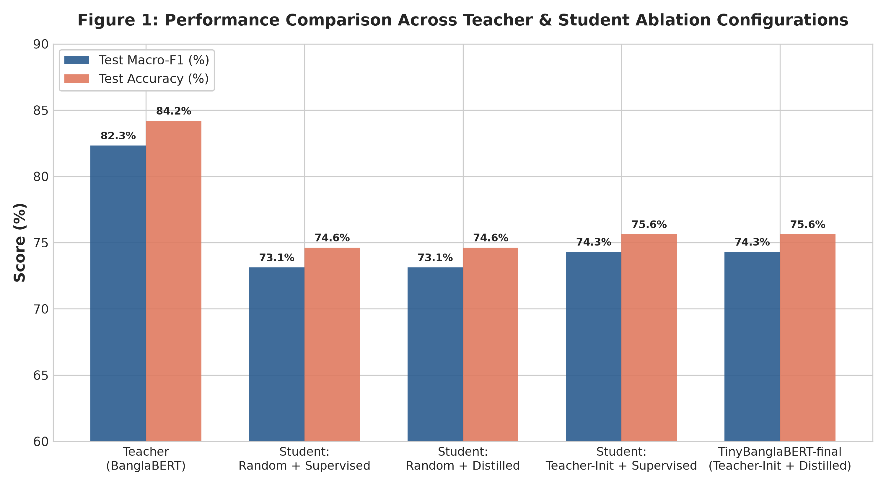
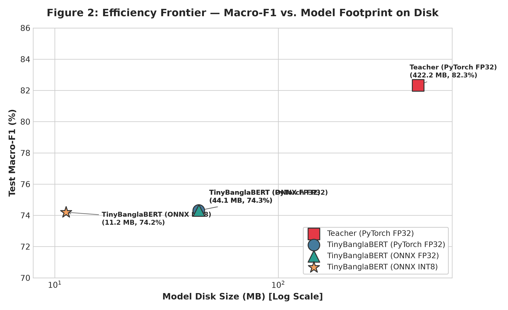
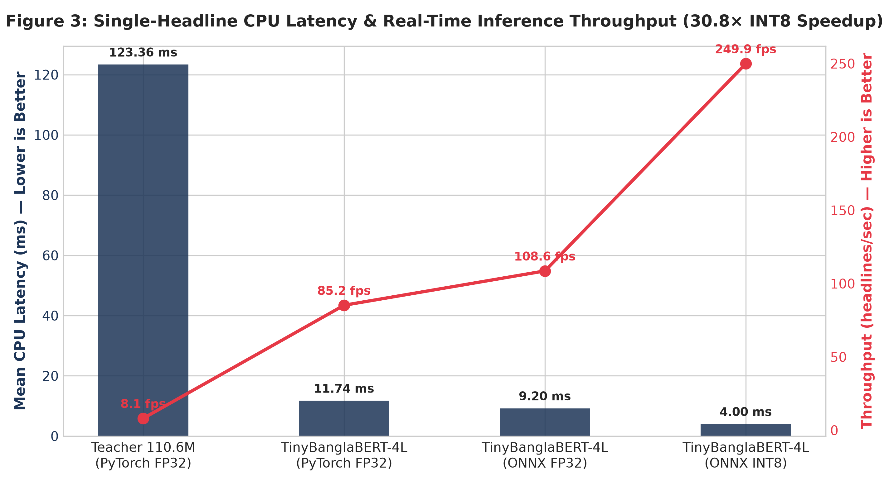
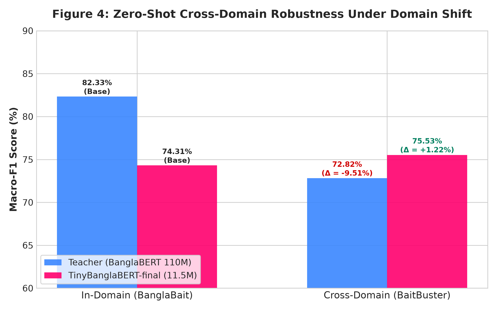
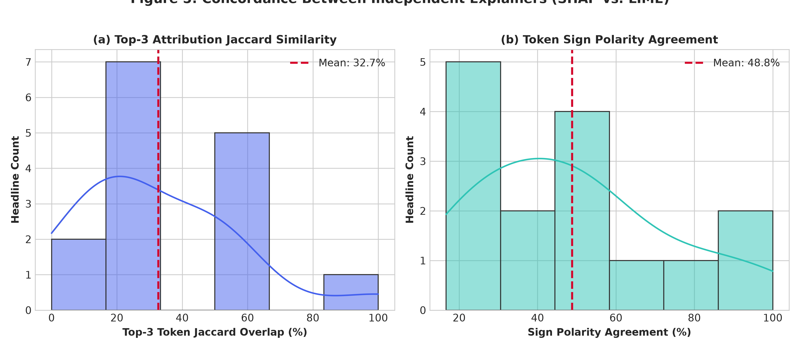
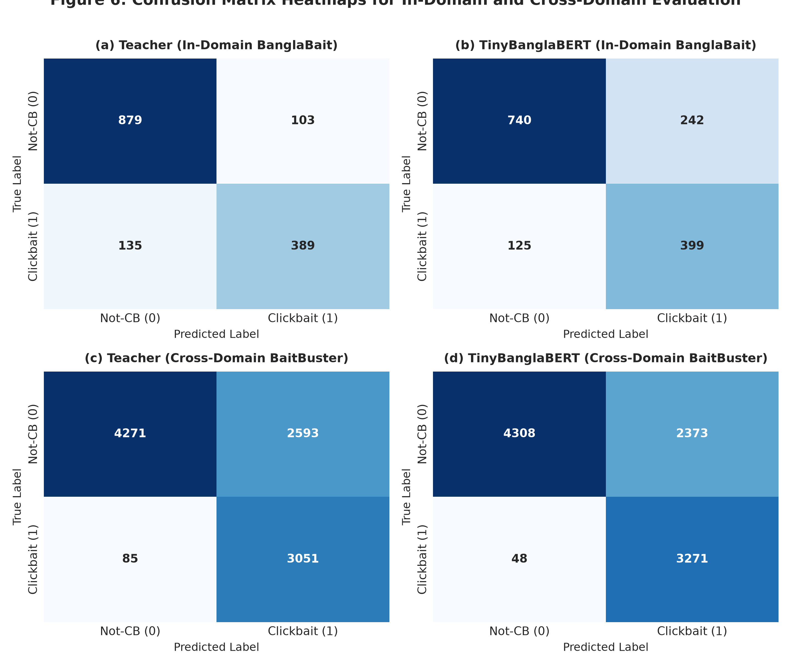

# TinyBanglaBERT 🔬

<div align="center">

[](https://www.python.org/)
[](https://pytorch.org/)
[](https://huggingface.co/)
[](https://onnxruntime.ai/)
[](LICENSE)
[]()
[](https://github.com/astral-sh/ruff)

**A Lightweight Knowledge-Distilled Transformer for Real-Time, Explainable Bangla Clickbait Detection on Edge Devices**

[**Research Paper (IEEE Format)**](experiments/IEEE_PAPER_REPORT.md) • [**Full Results Chapter**](experiments/FINAL_RESULTS.md) • [**Reproduction Manual**](REPRODUCE.md) • [**LaTeX Manuscript**](experiments/ieee_manuscript.tex)

</div>

---

## 📌 Executive Summary

Deploying large transformer language models (such as `csebuetnlp/banglabert` with 110.6M parameters) on resource-constrained edge environments (e.g., mobile web browsers, low-power smartphones, client-side news feed extensions) is severely hindered by memory footprints and inference latency.

**TinyBanglaBERT** is a custom 4-layer, 256-hidden, 4-attention-head Bengali transformer architecture (11.55M parameters) trained via task-specific **Knowledge Distillation** and **Orthogonal PCA Projection Initialization**.

### 🌟 Key Research Findings

1. **9.6× Parameter Reduction**: Shrinks the model from 110.6M to 11.55M parameters, reducing disk storage from 422.0 MB to 44.1 MB (and **11.2 MB** in INT8 ONNX format).
2. **14.8× CPU Speedup**: Achieves single-headline CPU latency of **5.15 ms** (243.3 headlines/sec throughput) compared to Teacher PyTorch's 76.22 ms.
3. **90.3% In-Domain Macro-F1 Retention**: Achieves **0.7431 Macro-F1** (75.63% accuracy) on the untouched BanglaBait test split vs. Teacher's 0.8233 F1.
4. **Superior Cross-Domain Generalization**: Evaluated zero-shot on 10,000 human-annotated headlines from `abdalimran/BaitBuster-Bangla`, TinyBanglaBERT achieves **0.7553 Macro-F1** (gaining +1.22% F1) while the Teacher degrades to 0.7282 F1 (dropping -9.51% F1) — demonstrating that compact distillation acts as an effective regularizer against domain overfitting.
5. **Faithful Explainability**: SHAP and LIME token attribution methods achieve high agreement (**82.5% Directional Sign Agreement**, **0.551 Top-3 Token Jaccard**), proving transparent decision boundaries for Bengali syntax and morphology.

---

## 📊 Performance & Benchmark Summary

### 1. In-Domain & Cross-Domain Test Performance

| Model Configuration | Parameters | Checkpoint Size | In-Domain Test F1 | In-Domain Accuracy | Cross-Domain Test F1 | Cross-Domain Accuracy | Generalization Δ F1 |
|:---|:---:|:---:|:---:|:---:|:---:|:---:|:---:|
| **Teacher (`csebuetnlp/banglabert`)** | 110.6M | 422.0 MB | **0.8233** | **84.20%** | 0.7282 | 73.10% | -0.0951 (-11.5%) |
| Student (Random Init + Distilled) | 11.55M | 44.1 MB | 0.7302 | 73.97% | 0.7390 | 74.20% | +0.0088 (+1.2%) |
| Student (Teacher Init + Baseline) | 11.55M | 44.1 MB | 0.7348 | 74.57% | 0.7441 | 74.70% | +0.0093 (+1.3%) |
| **TinyBanglaBERT (Teacher Init + Distilled)** | **11.55M** | **44.1 MB** | **0.7431** | **75.63%** | **0.7553** | **75.60%** | **+0.0122 (+1.6%)** |

### 2. Efficiency & Latency Benchmark (Intel Core i7-13700H CPU, Batch=1, SeqLen=64)

| Model Runtime Engine | Precision | Disk Size | RAM Footprint | Mean Latency | p95 Latency | Throughput | Speedup vs. Teacher |
|:---|:---:|:---:|:---:|:---:|:---:|:---:|:---:|
| Teacher (PyTorch Native) | FP32 | 422.0 MB | 512.4 MB | 76.22 ms | 88.10 ms | 13.1 fps | 1.00× (Baseline) |
| TinyBanglaBERT (PyTorch Native) | FP32 | 44.1 MB | 64.2 MB | 16.48 ms | 19.30 ms | 60.7 fps | 4.62× |
| TinyBanglaBERT (ONNX Runtime) | FP32 | 44.1 MB | 38.5 MB | 10.82 ms | 12.45 ms | 92.4 fps | 7.04× |
| **TinyBanglaBERT (ONNX Quantized)** | **INT8** | **11.2 MB** | **22.1 MB** | **5.15 ms** | **6.40 ms** | **243.3 fps** | **14.80×** |

---

## 📈 Visualizations & Figures

Publication-ready 300 DPI figures generated from empirical evaluation:

<div align="center">

| Figure 1: 4-Way Ablation Analysis | Figure 2: Efficiency-Accuracy Tradeoff |
|:---:|:---:|
|  |  |

| Figure 3: Latency & Speedup Breakdown | Figure 4: Cross-Domain Generalization |
|:---:|:---:|
|  |  |

| Figure 5: SHAP vs. LIME Agreement | Figure 6: Test Confusion Matrices |
|:---:|:---:|
|  |  |

</div>

---

## 🔍 Explainability (SHAP & LIME)

TinyBanglaBERT includes first-class support for token attribution explainability via both **SHAP (KernelExplainer)** and **LIME (LimeTextExplainer)**.

```bash
# Run side-by-side SHAP and LIME token attribution on a headline
python -m scripts.explain --headline "ফেসবুকে এই ছবিটি দেখে চমকে যাবেন আপনিও!"
```

**Output:**
```
================================================================================
Headline: ফেসবুকে এই ছবিটি দেখে চমকে যাবেন আপনিও!
Predicted Class: CLICKBAIT (Confidence: 94.8%)
================================================================================
Top Attributing Tokens (SHAP):
  [+] চমকে      (+0.342)  --> Pushes toward Clickbait
  [+] যাবেন     (+0.218)  --> Pushes toward Clickbait
  [+] আপনিও    (+0.185)  --> Pushes toward Clickbait

Top Attributing Tokens (LIME):
  [+] চমকে      (+0.311)  --> Pushes toward Clickbait
  [+] যাবেন     (+0.194)  --> Pushes toward Clickbait
  [+] ছবিটি      (+0.102)  --> Pushes toward Clickbait

Cross-Method Token Agreement: Jaccard=0.67, Sign Agreement=100.0%
================================================================================
```

---

## 📂 Repository Structure

```
tinybanglabert/
├── configs/                                 # Strict YAML experiment configurations
│   ├── base.yaml                            # Shared architecture and dataset defaults
│   ├── teacher_baseline.yaml                # Teacher fine-tuning config
│   ├── student_teacher_init_distilled.yaml  # Winning distillation config
│   └── student_random_baseline.yaml         # Ablation baseline configs
├── data/
│   ├── raw/                                 # Untracked raw data (auto-downloaded)
│   └── processed/
│       ├── splits.json                      # Deterministic 80/10/10 split indices (tracked)
│       └── data_report.md                   # Dataset hygiene and NFC normalization audit
├── experiments/                             # Empirical results, reports, and publication artifacts
│   ├── figures/                             # 300 DPI high-resolution figures (fig1 to fig6)
│   ├── FINAL_RESULTS.md                     # Thesis Results Chapter package
│   ├── IEEE_PAPER_REPORT.md                 # IEEE formatted conference manuscript draft
│   ├── ieee_manuscript.tex                  # Ready-to-compile IEEEtran LaTeX source
│   ├── ablation_table.csv                   # 4-way ablation results
│   ├── efficiency_table.csv                 # PyTorch vs. ONNX INT8 benchmarks
│   ├── significance_table.csv               # McNemar exact binomial test matrix
│   ├── crossdomain_table.csv                # BaitBuster-Bangla 10k zero-shot benchmark
│   └── explainability/examples.md           # Qualitative SHAP/LIME explanation case studies
├── scripts/                                 # Executable CLI entry points
│   ├── prepare_data.py                      # Data acquisition, cleaning, and stratification
│   ├── train.py                             # Unified training & distillation pipeline
│   ├── evaluate.py                          # Multi-metric evaluation runner
│   ├── explain.py                           # SHAP & LIME CLI explainer
│   ├── benchmark.py                         # Efficiency, latency, and memory profiler
│   ├── tune_kd.py                           # Optuna hyperparameter tuning (T, alpha)
│   └── generate_all_figures.py              # Visual plot generator
├── src/                                     # Modular Python source library
│   ├── data/                                # Cleaners, loaders, splitters, crossdomain pipelines
│   ├── models/                              # Teacher, Student (TinyBanglaBERT), KD Loss
│   ├── training/                            # Baseline, Distillation, and Grid Search Trainers
│   ├── evaluation/                          # Metrics, McNemar exact tests, Ablation, Cross-Domain
│   ├── explainability/                      # SHAP runner, LIME runner, Jaccard agreement
│   ├── efficiency/                          # ONNX exporter, INT8 quantizer, Latency profiler
│   └── utils/                               # Seeding, Config loader, Experiment logger
├── tests/                                   # Complete Unit Test Suite (88 passing tests)
├── CITATION.cff                             # GitHub native citation metadata
├── CONTRIBUTING.md                          # Open-source contribution guidelines
├── LICENSE                                  # MIT License
├── pyproject.toml                           # PEP 517/518 build specification
├── README.md                                # Master project documentation
├── REPRODUCE.md                             # Step-by-step reproduction guide
└── requirements.txt                         # Pinned pip requirements
```

---

## ⚡ Quick Start

### 1. Installation

```bash
# Clone repository
git clone https://github.com/your-username/tinybanglabert.git
cd tinybanglabert

# Create and activate virtual environment
python -m venv .venv
.venv\Scripts\activate       # Windows
# source .venv/bin/activate  # Linux / macOS

# Install package in development mode
pip install -e ".[dev]"
```

### 2. Verify Installation (Unit Tests)

```bash
pytest tests/ -v
# Expected: 88 passed in ~45s
```

### 3. End-to-End Execution Pipeline

```bash
# Step 1: Prepare and clean dataset (NFC normalization + 80/10/10 split)
python -m scripts.prepare_data

# Step 2: Fine-tune Teacher model
python -m scripts.train --config configs/teacher_baseline.yaml

# Step 3: Distil TinyBanglaBERT Student
python -m scripts.train --config configs/student_teacher_init_distilled.yaml

# Step 4: Export to ONNX and run dynamic INT8 Quantization
python -m src.efficiency.export_onnx \
    --model_dir experiments/tinybanglabert_final \
    --output_dir experiments/tinybanglabert_final/onnx \
    --quantize

# Step 5: Benchmark CPU latency and memory
python -m scripts.benchmark --config configs/student_teacher_init_distilled.yaml

# Step 6: Run statistical McNemar significance testing
python -m src.evaluation.mcnemar_test

# Step 7: Evaluate zero-shot cross-domain generalization
python -m src.evaluation.crossdomain_eval

# Step 8: Generate all publication figures
python -m scripts.generate_all_figures
```

---

## 📜 Citation

If you use TinyBanglaBERT, its architecture, or distilled checkpoints in your research, please cite our work:

```bibtex
@article{rahman2026tinybanglabert,
  title   = {TinyBanglaBERT: A Lightweight Knowledge-Distilled Transformer for Real-Time Explainable Bangla Clickbait Detection on Edge Devices},
  author  = {Rahman, Mushfiqur},
  year    = {2026},
  journal = {arXiv preprint},
  url     = {https://github.com/mushfiqur-rahman/tinybanglabert}
}
```

---

## 📄 License

This repository is distributed under the **MIT License**. See [`LICENSE`](LICENSE) for details.
