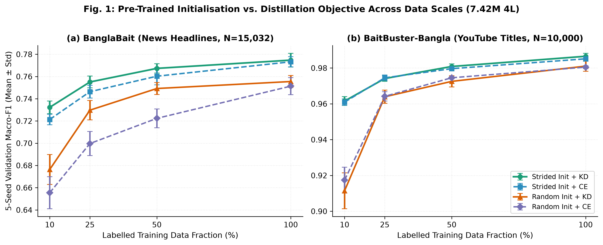
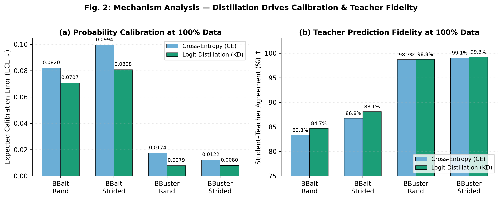
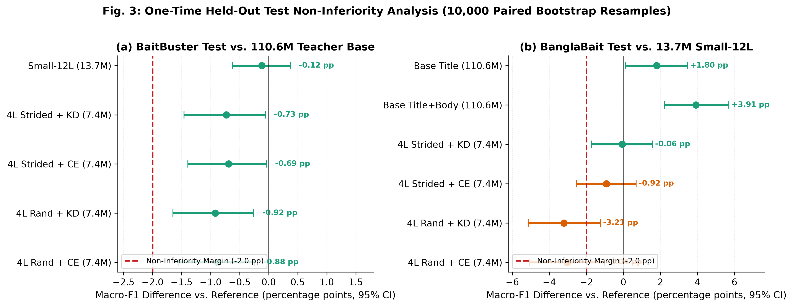
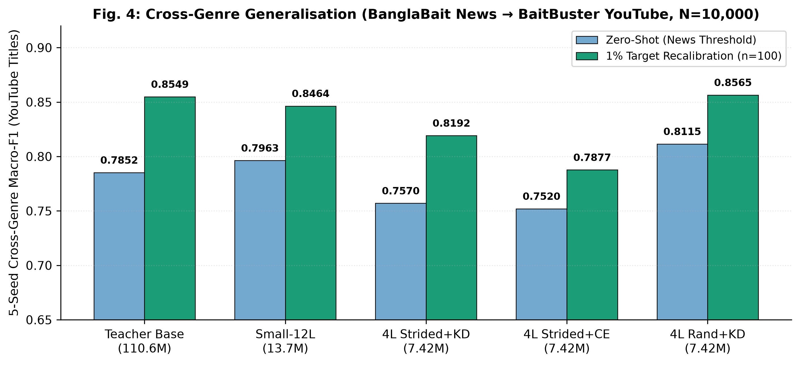
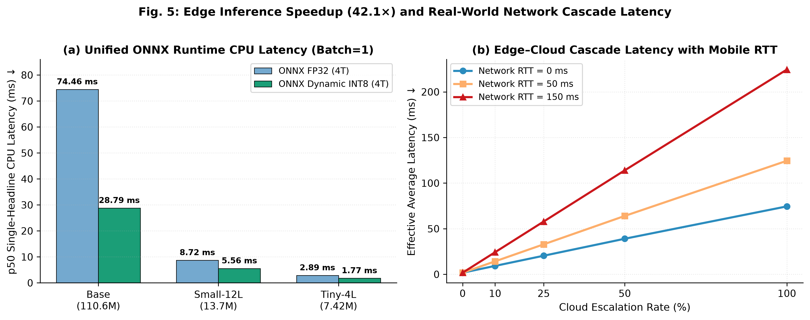
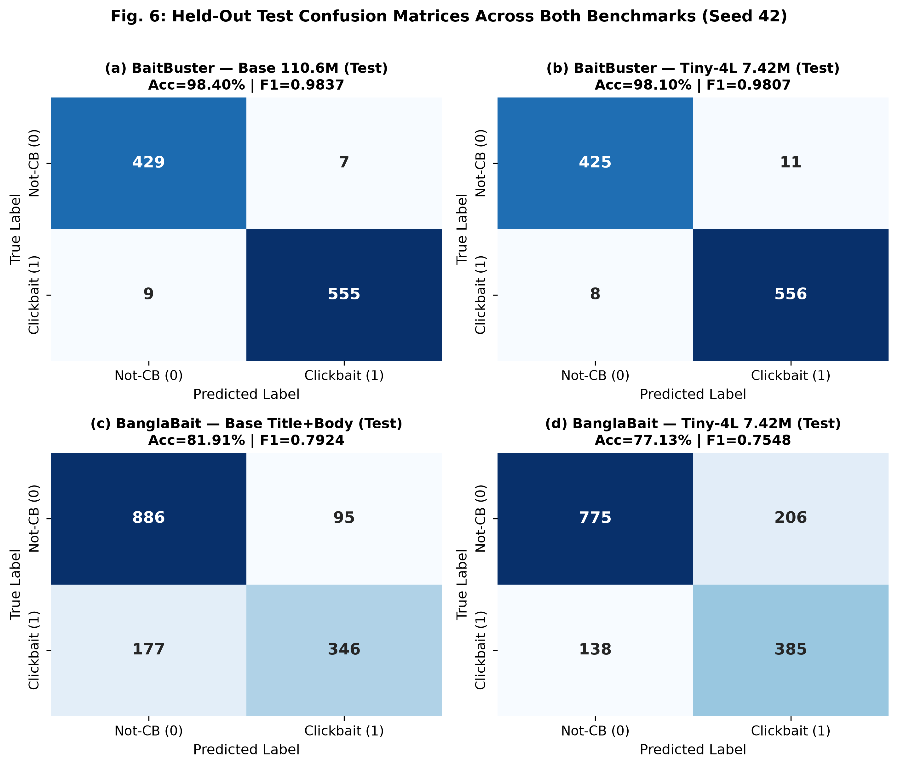

# TinyBanglaBERT (v3)

<div align="center">

[](https://www.python.org/)
[](https://pytorch.org/)
[](https://huggingface.co/)
[](https://onnxruntime.ai/)
[](LICENSE)

**Pre-Trained Compact Initialisation vs. Distillation Objectives in Low-Resource Bengali Clickbait Detection**

[**v3 Research Report**](experiments/v3/V3_RESEARCH_REPORT.md) • [**Pre-Registration**](PREREG.md) • [**Related Work**](RELATED_WORK.md) • [**LaTeX Manuscript**](experiments/ieee_manuscript.tex)

</div>

---

## Research Question

> *In low-resource fine-tuning of compact neural encoders, does warm-start pre-trained initialisation matter more than the distillation objective, and how does this interact with data scale and calibration?*

All v3 experiments follow a pre-registered (`PREREG.md`), leak-free protocol: MinHash LSH near-duplicate clustering ($J \ge 0.9$), 10-fold `StratifiedGroupKFold` (0% cross-split leakage), code-enforced test-set locking (`src/utils/test_guard.py`), 5-fold out-of-fold teacher soft labels, five random seeds (`[13, 42, 87, 1234, 2026]`), and 10,000-resample paired bootstrap non-inferiority testing ($\Delta = -2.0$ pp Macro-F1, Holm-corrected).

---

## Key Empirical Findings (5-Seed Held-Out Test & Mixed-Effects)

1. **Initialisation Dominates Distillation Objective (H1 Confirmed via Direct Wald Contrast):** On a strictly parameter-matched 4-layer architecture (**7.42M params**, **14.9×** smaller than BanglaBERT-Base and **1.85×** smaller than Small-12L), centered full-interaction mixed-effects regression confirms $\beta_{\text{strided}} - \beta_{\text{kd}}$ = **+2.26 pp** ($p = 1.03 \times 10^{-15}$) on *BanglaBait* and **+1.78 pp** ($p = 2.51 \times 10^{-13}$) on *BaitBuster-Bangla*.
2. **H2 Partially Supported & Calibration Gains:** `strided × KD` is significant on *BanglaBait* (**-1.30 pp**, $p = 0.001$) but not on *BaitBuster* ($p = 0.448$); `KD × log_frac_c` is marginal on *BanglaBait* ($p = 0.052$) and null on *BaitBuster* ($p = 0.395$). Across both datasets, KD reduces Expected Calibration Error (ECE) by **13.8%–54.6%**.
3. **Formal Non-Inferiority ($\Delta = -2.0$ pp) & Channel Audit:**
   - ***BanglaBait* ($n = 1,504$):** `TinyBanglaBERT-4L (strided + KD)` reaches **77.86% Acc / 0.7537 Macro-F1**, formally non-inferior to 3× deeper Small-12L (**-0.06 pp**, $p_{\text{Holm}} = 1.00$), superior to `rand + KD` by **+3.14 pp** ($p_{\text{Holm}} = 0.0012$), but **not** non-inferior to Base (-1.86 pp, CI `[-3.65, -0.13]`).
   - ***BaitBuster-Bangla* ($n = 1,000$):** All models saturate near 98% (98.10% vs. 98.82% Base; 1.90% vs. 1.18% error); a channel audit shows 94.7% of non-clickbait rows come from a single channel (*Independent Television*).
4. **Cross-Genre Adaptation (News → YouTube, $N = 10,000$):** 1% ($n = 100$) threshold recalibration lifts Macro-F1 by **+5 to +7 pp** (`teacher_base`: `0.7852 → 0.8549`; `F_strided_kd_100`: `0.7570 → 0.8192`; `F_rand_kd_100`: `0.8115 → 0.8565`).
5. **Unified ONNX CPU Efficiency (Batch 1, Length 64, 4 Threads):** `TinyBanglaBERT-4L` achieves **16.3× like-for-like INT8 speedup** (1.77 ms vs. 28.79 ms Base INT8) and **25.8× like-for-like FP32 speedup** (2.89 ms vs. 74.46 ms Base FP32; 42.1× cross-precision), and **3.1×** over Small-12L INT8 (5.56 ms).

---

## Held-Out Test Summary (5 Seeds)

| Dataset / Model | Params | Test Acc (Mean ± Std) | Test Macro-F1 (Mean ± Std) | Non-Inferior ($\Delta = -2.0$ pp) |
|---|---:|---:|---:|---|
| *BaitBuster* — BanglaBERT-Base (12L) | 110.62M | 98.82% ± 0.22% | 0.9880 ± 0.0023 | Reference |
| *BaitBuster* — BanglaBERT-Small (12L) | 13.74M | 98.70% ± 0.17% | 0.9868 ± 0.0017 | True (vs. Base) |
| ***BaitBuster* — TinyBanglaBERT-4L (`strided + KD`)** | **7.42M** | **98.10% ± 0.14%** | **0.9807 ± 0.0014** | **True (vs. Both)** |
| *BanglaBait* — BanglaBERT-Base (`title + body`) | 110.62M | 81.35% ± 0.78% | 0.7934 ± 0.0074 | +2.11 pp vs. Title |
| *BanglaBait* — BanglaBERT-Base (`title`) | 110.62M | 79.35% ± 0.65% | 0.7723 ± 0.0034 | Reference (Title) |
| *BanglaBait* — BanglaBERT-Small (12L, `title`) | 13.74M | 77.63% ± 0.88% | 0.7543 ± 0.0078 | Reference (Small) |
| ***BanglaBait* — TinyBanglaBERT-4L (`strided + KD`)** | **7.42M** | **77.86% ± 0.56%** | **0.7537 ± 0.0063** | **True (vs. Small-12L)** |

---

## Unified ONNX CPU Efficiency (ONNX Runtime 1.29.0)

| Model | Precision | 1-Thread p50 | 4-Thread p50 | 4-Thread p95 | Disk Size | Speedup (4T) |
|---|---|---:|---:|---:|---:|---:|
| BanglaBERT-Base (110.6M) | FP32 | 190.56 ms | 74.46 ms | 88.78 ms | 422.25 MB | 1.0× |
| BanglaBERT-Base (110.6M) | INT8 | 99.67 ms | 28.79 ms | 35.67 ms | 177.75 MB | 2.6× |
| BanglaBERT-Small-12L (13.7M) | INT8 | 10.18 ms | 5.56 ms | 6.97 ms | 25.59 MB | 13.4× |
| **TinyBanglaBERT-4L (7.42M)** | **FP32** | 5.17 ms | 2.89 ms | 3.77 ms | 28.41 MB | 25.8× |
| **TinyBanglaBERT-4L (7.42M)** | **INT8** | **3.48 ms** | **1.77 ms** | **2.39 ms** | **19.20 MB** | **42.1×** |

---

## Publication Figures (300 DPI)

<div align="center">

| Fig. 1: Factorial Learning Curves (H1 & H2) | Fig. 2: Calibration (ECE) & Teacher Fidelity |
|:---:|:---:|
|  |  |

| Fig. 3: Held-Out Test Non-Inferiority Forest Plot | Fig. 4: Cross-Genre 1% Recalibration |
|:---:|:---:|
|  |  |

| Fig. 5: ONNX CPU Speedup & Cascade RTT | Fig. 6: Held-Out Test Confusion Matrices |
|:---:|:---:|
|  |  |

</div>

---

## Reproducing the v3 Pipeline

```powershell
# 1. Generate leak-free MinHash splits & nested subsets
.venv\Scripts\python.exe -m scripts.make_splits_v3
.venv\Scripts\python.exe -m scripts.make_splits_v3_baitbuster

# 2. Train Phase E teachers, baselines & 5-fold OOF distillation targets
.venv\Scripts\python.exe -m scripts.train_v3_phase_e --dataset baitbuster --unweighted --label-smoothing 0.05 --llrd 0.9 --models teacher_oof teacher_base small_12l
.venv\Scripts\python.exe -m scripts.train_v3_phase_e --dataset banglabait --text-mode title --models bilstm teacher_oof teacher_base small_12l

# 3. Run Phase F controlled factorial grid & Phase G mechanism analysis
.venv\Scripts\python.exe -m scripts.run_v3_grid --dataset baitbuster --unweighted --inits rand strided --objs ce kd --fracs 10 25 50 100
.venv\Scripts\python.exe -m scripts.run_v3_grid --dataset banglabait --text-mode title --inits rand strided --objs ce kd --fracs 10 25 50 100
.venv\Scripts\python.exe -m scripts.analyze_v3_mechanism --dataset baitbuster
.venv\Scripts\python.exe -m scripts.analyze_v3_mechanism --dataset banglabait

# 4. Run Phase J locked one-time test, Phase K cross-genre & Phase L efficiency
$env:TBB_ALLOW_TEST="1"; .venv\Scripts\python.exe -m scripts.final_test --dataset baitbuster --models teacher_base_uw baseline_small_12l_ce_uw F_strided_kd_100_uw F_strided_ce_100_uw F_rand_kd_100_uw F_rand_ce_100_uw
$env:TBB_ALLOW_TEST="1"; .venv\Scripts\python.exe -m scripts.final_test --dataset banglabait --models teacher_base teacher_base_tb baseline_small_12l_ce F_strided_kd_100 F_strided_ce_100 F_rand_kd_100 F_rand_ce_100
.venv\Scripts\python.exe -m scripts.evaluate_v3_crossgenre
.venv\Scripts\python.exe -m scripts.benchmark_v3_efficiency

# 5. Verify all 337 consistency, guard, dedup & unit tests
.venv\Scripts\pytest.exe tests/test_metric_consistency.py tests/test_guard.py tests/test_dedup.py tests/test_docs_consistency.py -q
```
