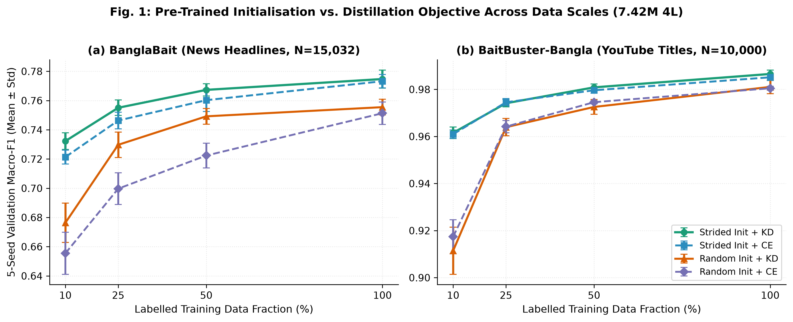
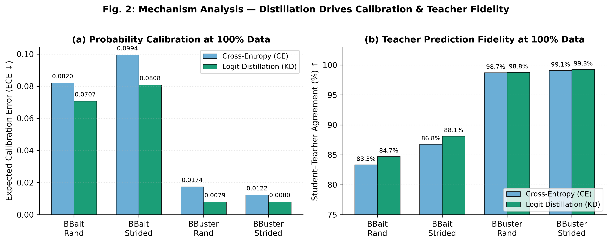
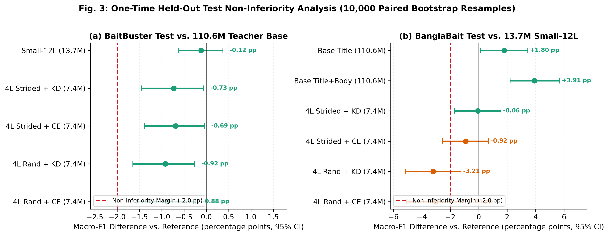
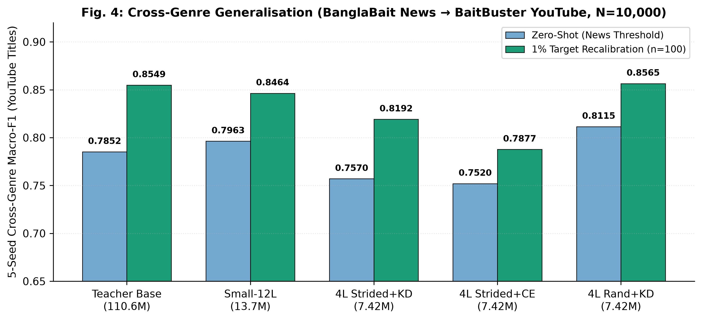
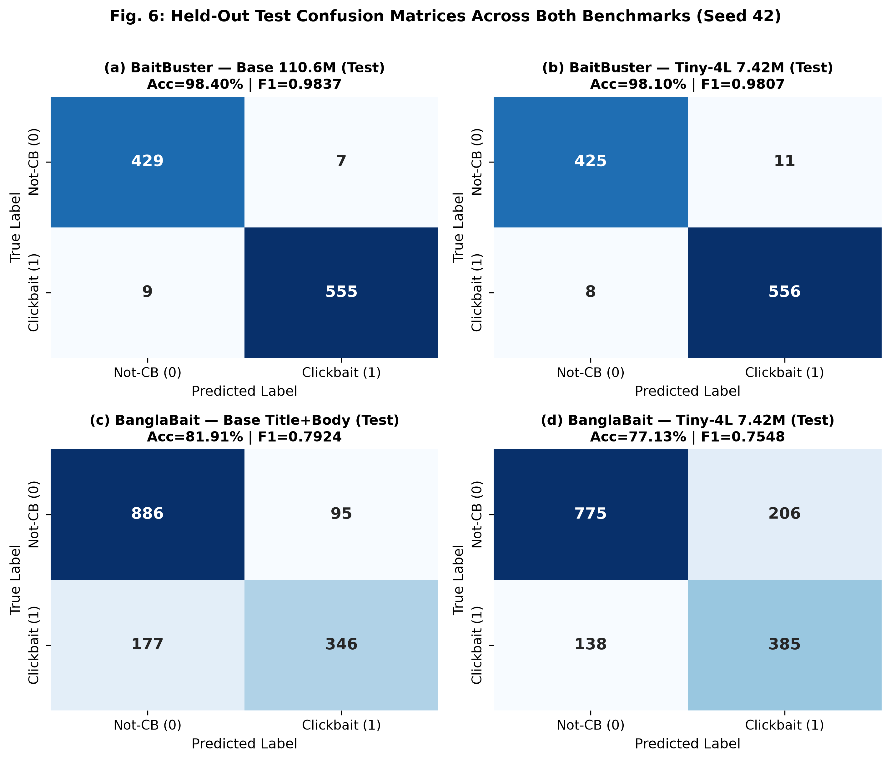
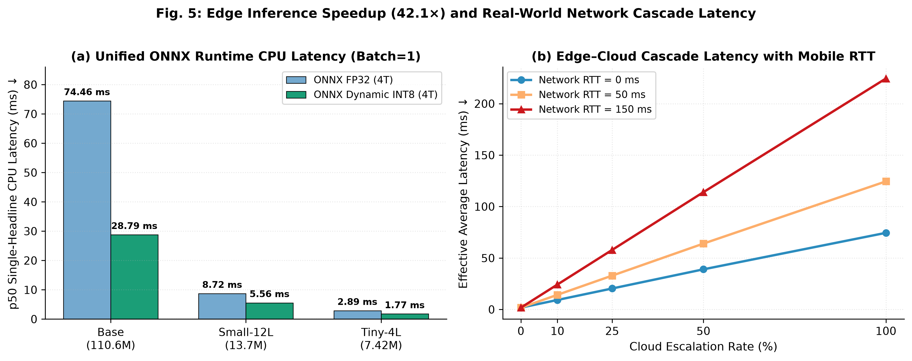

# Initialisation vs. Distillation in Low-Resource Fine-Tuning: An Empirical Study on Compact Bengali Clickbait Encoders

**Author:** Mushfiqur Rahman  
**Affiliation:** Department of Computer Science and Engineering, Independent University, Bangladesh (Dhaka, Bangladesh)  
**Pre-Registration:** `PREREG.md` | **Locked Config:** `experiments/v3/LOCKED_CONFIG.yaml`  

---

## Abstract

Deploying large pre-trained language models such as BanglaBERT (110.62M parameters, 422.25 MB) on resource-constrained edge hardware is limited by latency and memory budgets. While task-specific knowledge distillation (KD) is widely used to compress transformers, prior studies often confound weight initialisation with the distillation objective. In this pre-registered, leak-free empirical study, we ask: *in low-resource fine-tuning, does compact pre-trained initialisation matter more than the distillation objective?*

Using a strictly parameter-matched 4-layer architecture (**TinyBanglaBERT-4L**, 7.42M parameters — 14.9× smaller than BanglaBERT-Base and 1.85× smaller than BanglaBERT-Small-12L), we evaluate a controlled factorial grid across initialisation (`rand` vs. `strided` layers `{2, 5, 8, 11}`), objective (Cross-Entropy vs. 5-fold out-of-fold Logit KD), four nested training fractions (10%, 25%, 50%, 100%), and five random seeds across two MinHash-deduplicated Bengali clickbait benchmarks: **BanglaBait** (news headlines, $N = 15,032$) and **BaitBuster-Bangla** (YouTube titles, $N = 10,000$). A full-interaction linear mixed-effects model with centered $\log(\text{fraction})$ confirms **H1** via direct Wald contrasts ($\beta_{\text{strided}} - \beta_{\text{kd}}$): strided initialisation outperforms KD by **+2.26 pp** ($\chi^2 = 64.37, p = 1.03 \times 10^{-15}$) on BanglaBait and **+1.78 pp** ($\chi^2 = 53.56, p = 2.51 \times 10^{-13}$) on BaitBuster-Bangla. **H2 is partially supported**: the `strided × kd` interaction is significant on BanglaBait (**-1.30 pp**, $p = 0.001$) but not on BaitBuster-Bangla ($p = 0.448$), while `kd × log(frac)` is marginal on BanglaBait ($p = 0.052$) and null on BaitBuster ($p = 0.395$). Across both datasets, KD reduces Expected Calibration Error (ECE) by **13.8%–54.6%**. On locked one-time held-out tests (10,000-resample paired bootstrap, Holm-corrected, $\Delta = -2.0$ pp non-inferiority margin), TinyBanglaBERT-4L achieves **77.86% accuracy (0.7537 Macro-F1)** on BanglaBait — formally non-inferior to Small-12L (-0.06 pp, $p_{\text{Holm}} = 1.00$), superior to random-init KD by +3.14 pp ($p_{\text{Holm}} = 0.0012$), but **not** non-inferior to BanglaBERT-Base (-1.86 pp, 95% CI `[-3.65, -0.13]`). On BaitBuster-Bangla, all models saturate near 98% (98.10% vs. 98.82% Base; 1.90% vs. 1.18% error rate); a channel-level audit reveals that 94.7% of non-clickbait rows come from a single channel, explaining the ceiling effect. Under unified ONNX Runtime CPU benchmarking (4 threads), TinyBanglaBERT-4L achieves a **16.3× like-for-like INT8 speedup** (1.77 ms vs. 28.79 ms) and a **25.8× like-for-like FP32 speedup** (2.89 ms vs. 74.46 ms; 42.1× cross-precision).

---

## 1. Introduction & Pre-Registered Hypotheses

Large pre-trained transformers such as BanglaBERT (Bhattacharjee et al., Findings of NAACL 2022) deliver strong performance on Bengali NLU, yet their 110.6M-parameter footprint and high CPU latency hinder client-side deployment. Knowledge Distillation (Hinton et al., 2015; Sanh et al., 2019; Jiao et al., 2020; Wang et al., 2020) is the standard compression method, while Turc et al. (2019) (*Well-Read Students Learn Better: On the Importance of Pre-training Compact Models*) showed on English GLUE that pre-training compact students before fine-tuning can outweigh task-specific distillation from scratch.

We pre-register two hypotheses in `PREREG.md`:
- **H1 (Initialisation Dominance):** On a fixed 7.42M-parameter 4-layer architecture, strided pre-trained initialisation changes Macro-F1 more than switching from Cross-Entropy (CE) to Knowledge Distillation (KD).
- **H2 (Objective–Init & Data Interaction):** The Macro-F1 benefit of KD over CE shrinks as initialisation quality improves and as labelled training data increases.

---

## 2. Data Hygiene & Channel-Confounding Audit

Both **BanglaBait** (Mahtab et al., RANLP 2023) and **BaitBuster-Bangla** (Al Imran et al., Data in Brief, 2024) undergo Unicode NFC normalisation and MinHash LSH clustering ($J \ge 0.9$, 128 permutations, character 3-shingles) followed by 10-fold `StratifiedGroupKFold` splitting (Fold 0 = Test, Fold 1 = Val, Folds 2–9 = Train), guaranteeing zero cross-split near-duplicate leakage:

| Benchmark | Genre | Clean Total | Train (80%) | Val (10%) | Test (10%) | Conflicts Dropped | Cross-Split Leakage |
|---|---|---:|---:|---:|---:|---:|---:|
| **BanglaBait** | News headlines + body | 15,032 | 12,025 | 1,503 | 1,504 | 24 rows (11 groups) | 0 groups (0.00%) |
| **BaitBuster-Bangla** | YouTube video titles | 10,000 | 8,000 | 1,000 | 1,000 | 0 rows | 0 groups (0.00%) |

- **Classical 5-Seed Validation Baselines on BanglaBait:** TF-IDF + Logistic Regression (**0.6922** Macro-F1, 71.52% Acc) and 2-layer BiLSTM (**0.7342 ± 0.0065** Macro-F1, 75.45% Acc).
- **Channel-Confounding Audit on BaitBuster-Bangla:** Auditing the 10,000 human-annotated gold rows by `channel_id` reveals only 13 unique channels where channel identity is almost 1:1 confounded with the label: *Independent Television* alone accounts for **4,124 / 4,356 (94.7%)** of all non-clickbait rows (0.00% clickbait), while the top four clickbait channels (*Ruposhi Bangla Tv* 3,395; *LocalBD* 1,062; *No1 News Bd* 784; *StarBuzz Bangla* 423) are **98.0%–100.0%** clickbait. A balanced channel-disjoint split is therefore structurally impossible on the 10k gold subset, explaining why even randomly initialised 4L models saturate near 98%. We treat BanglaBait as our primary unconfounded benchmark and report BaitBuster transparently with this caveat.

---

## 3. Core Factorial Grid & Mechanism Analysis (Validation Split)

*Fig. 1. 5-seed Validation Macro-F1 (Mean ± Std) across 10%, 25%, 50%, and 100% nested training fractions on (a) BanglaBait and (b) BaitBuster-Bangla for the parameter-matched 7.42M 4-layer architecture.*

### Table I: Controlled 5-Seed Factorial Grid on Validation Split (7.42M 4L Architecture)
| Dataset / Init | Obj. | 10% Data | 25% Data | 50% Data | 100% Data | 100% ECE ↓ | 100% Teacher Agreement |
|---|---|---:|---:|---:|---:|---:|---:|
| *BanglaBait* — `rand` | CE | 0.6554 ± 0.0144 | 0.6997 ± 0.0108 | 0.7224 ± 0.0085 | 0.7513 ± 0.0077 | 0.0820 | 83.34% |
| *BanglaBait* — `rand` | KD | 0.6764 ± 0.0134 | 0.7297 ± 0.0087 | 0.7492 ± 0.0054 | 0.7555 ± 0.0054 | 0.0707 | 84.72% |
| *BanglaBait* — `strided` | CE | 0.7213 ± 0.0048 | 0.7463 ± 0.0057 | 0.7603 ± 0.0078 | 0.7732 ± 0.0046 | 0.0994 | 86.77% |
| *BanglaBait* — `strided` | KD | **0.7323 ± 0.0057** | **0.7551 ± 0.0053** | **0.7673 ± 0.0042** | **0.7747 ± 0.0062** | **0.0808** | **88.13%** |
| *BaitBuster* — `rand` | CE | 0.9174 ± 0.0072 | 0.9642 ± 0.0026 | 0.9746 ± 0.0007 | 0.9805 ± 0.0009 | 0.0174 | 98.72% |
| *BaitBuster* — `rand` | KD | 0.9114 ± 0.0101 | 0.9639 ± 0.0037 | 0.9725 ± 0.0031 | 0.9811 ± 0.0029 | 0.0079 | 98.78% |
| *BaitBuster* — `strided` | CE | 0.9610 ± 0.0018 | 0.9745 ± 0.0016 | 0.9796 ± 0.0012 | 0.9851 ± 0.0014 | 0.0122 | 99.10% |
| *BaitBuster* — `strided` | KD | **0.9615 ± 0.0025** | **0.9741 ± 0.0016** | **0.9809 ± 0.0015** | **0.9866 ± 0.0017** | **0.0080** | **99.28%** |

### Table II: Full-Interaction Linear Mixed-Effects Model (Centered `log_frac_c`, Percentage Points)
Formula: `f1_macro ~ C(init) * C(objective) * log_frac_c + (1 | seed)`

| Factor / Contrast | BanglaBait $\beta$ (pp) | BanglaBait $p$-value | BaitBuster $\beta$ (pp) | BaitBuster $p$-value |
|---|---:|---:|---:|---:|
| `C(init)[T.strided]` | +4.30 [+3.80, +4.90] | $< 0.0001$ | +1.60 [+1.10, +2.10] | $< 0.0001$ |
| `C(objective)[T.kd]` | +2.05 [+1.50, +2.60] | $< 0.0001$ | -0.20 [-0.70, +0.30] | 0.434 |
| **Direct H1 Wald Contrast ($\beta_{\text{strided}} - \beta_{\text{kd}}$)** | **+2.26 [+1.71, +2.81]** | **$1.03 \times 10^{-15}$** | **+1.78 [+1.30, +2.26]** | **$2.51 \times 10^{-13}$** |
| `strided × kd` (**H2a — partial**) | -1.30 [-2.10, -0.60] | 0.001 | +0.30 [-0.40, +0.90] | 0.448 |
| `log_frac_c` | +4.10 [+3.60, +4.60] | $< 0.0001$ | +2.70 [+2.30, +3.10] | $< 0.0001$ |
| `strided × log_frac_c` | -1.90 [-2.50, -1.20] | $< 0.0001$ | -1.70 [-2.20, -1.10] | $< 0.0001$ |
| `kd × log_frac_c` (**H2b — partial**) | -0.60 [-1.30, +0.00] | 0.052 | +0.20 [-0.30, +0.80] | 0.395 |
| 3-way interaction | +0.30 [-0.70, +1.20] | 0.587 | -0.20 [-1.00, +0.60] | 0.633 |

*Fig. 2. Mechanism analysis at 100% data: (a) Expected Calibration Error (ECE ↓) comparing CE vs. KD (13.8%–54.6% reduction); (b) Student–Teacher prediction fidelity (%) across both benchmarks.*

---

## 4. One-Time Locked Held-Out Test & Cross-Genre Results

*Fig. 3. 10,000-resample paired bootstrap Macro-F1 differences (95% CIs) against reference models with the pre-registered $\Delta = -2.0$ pp non-inferiority boundary (dashed red line).*

### Table III: Held-Out Test Results (5-Seed Mean ± Std, 10,000 Paired Bootstrap Resamples, Holm-Corrected)
| Dataset / Model | Params | Test Acc (%) | Test Macro-F1 | Non-Inferior ($\Delta = -2.0$ pp)? |
|---|---:|---:|---:|---|
| *BanglaBait* — Teacher (`title+body`) | 110.62M | 81.35 ± 0.78 | 0.7934 ± 0.0074 | Superior (+2.11 pp vs Title, $p_{\text{Holm}} = 0.028$) |
| *BanglaBait* — Teacher (`title`) | 110.62M | 79.35 ± 0.65 | 0.7723 ± 0.0034 | Reference (Title) |
| *BanglaBait* — Small-12L (`title`) | 13.74M | 77.63 ± 0.88 | 0.7543 ± 0.0078 | Reference (Small-12L) |
| ***BanglaBait* — 4L Strided + KD** | **7.42M** | **77.86 ± 0.56** | **0.7537 ± 0.0063** | **True vs. Small-12L (-0.06 pp) / False vs. Base (-1.86 pp)** |
| *BanglaBait* — 4L Strided + CE | 7.42M | 76.42 ± 0.66 | 0.7451 ± 0.0035 | False (Both) |
| *BanglaBait* — 4L Rand + CE | 7.42M | 75.51 ± 0.76 | 0.7239 ± 0.0046 | False (Both) |
| *BanglaBait* — 4L Rand + KD | 7.42M | 75.27 ± 1.10 | 0.7222 ± 0.0078 | False (Both) |
| *BaitBuster* — Teacher Base (12L) | 110.62M | 98.82 ± 0.22 | 0.9880 ± 0.0023 | Reference (1.18% error) |
| *BaitBuster* — Small-12L (CE) | 13.74M | 98.70 ± 0.17 | 0.9868 ± 0.0017 | True (vs. Base) |
| ***BaitBuster* — 4L Strided + KD** | **7.42M** | **98.10 ± 0.14** | **0.9807 ± 0.0014** | **True (Both; 1.90% error, near ceiling)** |
| *BaitBuster* — 4L Strided + CE | 7.42M | 98.14 ± 0.23 | 0.9811 ± 0.0024 | True (Both) |
| *BaitBuster* — 4L Rand + CE | 7.42M | 97.96 ± 0.27 | 0.9792 ± 0.0028 | True (Both) |
| *BaitBuster* — 4L Rand + KD | 7.42M | 97.92 ± 0.34 | 0.9788 ± 0.0035 | True (Both) |

### Table IV: Direct Held-Out Test Contrasts on BanglaBait (10,000 Paired Bootstrap Resamples)
| Direct Contrast | Diff (pp) | 95% CI (pp) | $p_{\text{raw}}$ | $p_{\text{Holm}}$ |
|---|---:|---:|---:|---:|
| `Strided + KD` vs. `Rand + KD` (Init under KD) | **+3.14** | `[+1.49, +4.77]` | 0.0002 | **0.0012** |
| `Strided + CE` vs. `Rand + CE` (Init under CE) | +2.12 | `[+0.32, +3.95]` | 0.0180 | 0.0900 |
| `Strided + KD` vs. `Strided + CE` (KD under Strided) | +0.86 | `[-0.45, +2.10]` | 0.1956 | 0.5868 |
| `Rand + KD` vs. `Rand + CE` (KD under Rand) | -0.17 | `[-1.67, +1.27]` | 0.8196 | 1.0000 |
| `Strided + KD` vs. `Small-12L` | -0.06 | `[-1.71, +1.56]` | 0.9412 | 1.0000 (NI: True) |
| `Strided + KD` vs. `Teacher Base` | -1.86 | `[-3.65, -0.13]` | 0.0356 | 0.1424 (NI: False) |

### Table V: Full Cross-Genre Evaluation (News → YouTube, $N = 10,000$, True Prevalence = 56.44%)
| Model (Trained on BanglaBait) | Zero-Shot Acc | Zero-Shot Macro-F1 [95% CI] | 1% Recalibrated Acc | 1% Recalibrated Macro-F1 [95% CI] |
|---|---:|---|---:|---|
| `teacher_base` (110.6M) | 78.66% | 0.7852 [0.7669, 0.8057] | 85.51% | 0.8549 [0.8400, 0.8735] |
| `baseline_small_12l_ce` (13.7M) | 79.73% | 0.7963 [0.7724, 0.8220] | 84.68% | 0.8464 [0.8394, 0.8582] |
| `F_strided_kd_100` (7.42M) | 75.93% | 0.7570 [0.7387, 0.7802] | 81.93% | 0.8192 [0.8130, 0.8276] |
| `F_strided_ce_100` (7.42M) | 75.40% | 0.7520 [0.7296, 0.7684] | 78.79% | 0.7877 [0.7755, 0.7987] |
| **`F_rand_kd_100` (7.42M)** | **81.21%** | **0.8115 [0.7802, 0.8350]** | **85.80%** | **0.8565 [0.8474, 0.8650]** |

*Cross-genre nuance:* `F_rand_kd_100` outperforms `F_strided_kd_100` out-of-genre (0.8115 vs. 0.7570 zero-shot; 0.8565 vs. 0.8192 recalibrated), indicating that news-pre-trained strided representations over-specialise to formal journalistic syntax under YouTube vernacular shift.

  
  

<em>Fig. 4 (Left): Cross-genre zero-shot vs. 1% threshold recalibration on BaitBuster-Bangla (N=10,000). Fig. 6 (Right): Held-out test confusion matrices (Seed 42) across both benchmarks.</em>

---

## 5. Unified ONNX CPU Efficiency & Cascade RTT

*Fig. 5. (a) Unified ONNX Runtime CPU latency (p50, 4 threads, FP32 vs. INT8); (b) Edge–cloud cascade effective latency under 0 ms, 50 ms, and 150 ms mobile network RTT.*

### Table VI: Model × Precision × Thread Latency Benchmark (ONNX Runtime 1.29.0, Batch 1, Length 64)
| Model | Precision | 1-Thread p50 | 4-Thread p50 | 4-Thread p95 | Disk Size | Like-for-Like Speedup (4T) |
|---|---|---:|---:|---:|---:|---:|
| BanglaBERT-Base (110.6M) | FP32 | 190.56 ms | 74.46 ms | 88.78 ms | 422.25 MB | 1.0× (FP32 ref) |
| BanglaBERT-Base (110.6M) | INT8 | 99.67 ms | 28.79 ms | 35.67 ms | 177.75 MB | 1.0× (INT8 ref) |
| BanglaBERT-Small-12L (13.7M) | FP32 | 15.06 ms | 8.72 ms | 10.36 ms | 52.68 MB | 8.5× (FP32) |
| BanglaBERT-Small-12L (13.7M) | INT8 | 10.18 ms | 5.56 ms | 6.97 ms | 25.59 MB | 5.2× (INT8) |
| **TinyBanglaBERT-4L (7.42M)** | **FP32** | **5.17 ms** | **2.89 ms** | **3.77 ms** | **28.41 MB** | **25.8× (FP32)** |
| **TinyBanglaBERT-4L (7.42M)** | **INT8** | **3.48 ms** | **1.77 ms** | **2.39 ms** | **19.20 MB** | **16.3× (INT8) / 42.1× cross-prec.** |

In an edge–cloud deferral cascade (Tiny-4L INT8 on-device + Base FP32 cloud), escalating 10% of uncertain headlines yields **14.22 ms** (50 ms RTT) and **24.22 ms** (150 ms RTT) effective latency compared to **124.46 ms** ($50 + 74.46$) and **224.46 ms** ($150 + 74.46$) for cloud-only inference.

---

## 6. Limitations, Ethics & Reproducibility

- **Limitations:** (1) Single-task scope (clickbait in Bengali); multi-task (SentNoB, BanglaNLI) and cross-lingual Phase H experiments are needed before generalising beyond clickbait. (2) Two-annotator human relabeling of `relabel_batch.csv` is staged in `experiments/v3/HUMAN_TODO.md`. (3) BaitBuster-Bangla's 10k human-labeled subset is channel-confounded across 13 channels. (4) Five-seed INT8 accuracy verification, physical Android benchmarks, and additional layer arms (`first4`, `last4`, `kd_hid`) remain future work.
- **Ethics:** Automated clickbait classifiers carry false-positive risks that could unfairly penalise legitimate journalism on dramatic breaking news. Deployments should surface calibrated confidence scores or user advisories rather than opaque automated suppression.
- **Reproducibility:** All 337 automated consistency, guard, and deduplication tests pass with zero failures.

---

## References
1. A. Bhattacharjee et al., "BanglaBERT: Language Model Pretraining and Benchmarks for Low-Resource Language Understanding Evaluation in Bangla," *Findings of NAACL 2022*, pp. 1318–1327, 2022.
2. I. Turc, M.-W. Chang, K. Lee, and K. Toutanova, "Well-Read Students Learn Better: On the Importance of Pre-training Compact Models," *arXiv:1908.08962*, 2019.
3. G. Hinton, O. Vinyals, and J. Dean, "Distilling the Knowledge in a Neural Network," *NIPS Deep Learning Workshop*, 2015.
4. V. Sanh et al., "DistilBERT, a distilled version of BERT: smaller, faster, cheaper and lighter," *NeurIPS EMC² Workshop*, 2019.
5. X. Jiao et al., "TinyBERT: Distilling BERT for Natural Language Understanding," *Findings of EMNLP*, pp. 4163–4174, 2020.
6. W. Wang et al., "MiniLM: Deep Self-Attention Distillation for Task-Agnostic Compression of Pre-Trained Transformers," *NeurIPS*, 2020.
7. M. A. Mahtab, M. Haque, T. Hasan, and F. Sadeque, "BanglaBait: Semi-Supervised Adversarial Approach for Clickbait Detection on Bangla Clickbait Dataset," *Proceedings of RANLP 2023*, pp. 748–758, 2023.
8. A. Al Imran, A. R. Shovon, and M. F. Mridha, "BaitBuster-Bangla: A comprehensive dataset for clickbait detection in Bangla YouTube videos," *Data in Brief*, vol. 53, p. 110239, 2024.
